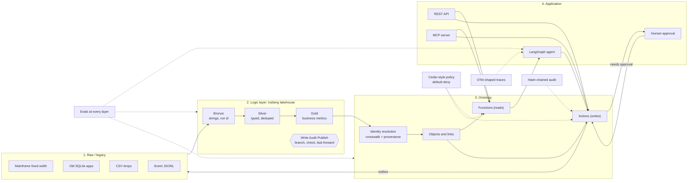
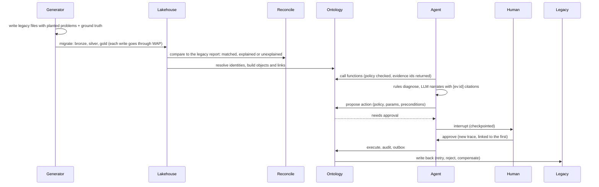

# Ironwright

I built Ironwright to show one thing end to end: how you take a company that runs on old systems
(mainframe files, aging databases, CSV drops) and get it to a point where AI agents can make real
business decisions on top of it, safely.

It's not one demo. It's one engine and four mock businesses, each with its own legacy mess,
its own ontology and its own agent:

| Pack | Company | The decision the agent takes on |
|---|---|---|
| `retail` | Brightline Retail | Why is this item underperforming in this store, and what do we do? |
| `supply_chain` | Corvane Distribution | This shipment is late. Why, and expedite, reroute or just tell the customer? |
| `banking_aml` | Harborview Bank | Is this AML alert worth escalating, or can it be recommended for closure? |
| `insurance_claims` | Granite Mutual | Fast track this claim, send it to coverage review, or refer it to SIU? |

Everything runs on a laptop for $0. No Docker, no API keys, no cloud account.

## The stack in one picture



## What happens when you run it



## Quickstart

```bash
python -m venv .venv && source .venv/bin/activate
pip install -e ".[dev]"

ironwright run --pack all          # generate, migrate, reconcile, ontology, agents, evals, export
ironwright trace --pack retail     # print the nested span tree of the latest agent run
make demo                         # serve the web demo on http://localhost:8001
ironwright serve --pack banking_aml   # REST API on :8000 (try the X-Principal header)
ironwright mcp --pack retail          # MCP server: tools are generated from ontology.yaml
pytest -q                         # every pack must pass every eval layer
```

Each stage also runs on its own: `ironwright generate|migrate|reconcile|ontology|agents|evals|export --pack <name>`.

### Using a real LLM (optional)

The default is `offline`: a template narrator, so runs are free and deterministic. The agent's
decisions come from rules either way. The model only writes the explanation, and a guardrail
rewrites any narration that cites evidence the agent never gathered.

```bash
IRONWRIGHT_LLM=ollama ironwright agents --pack retail                 # free, local
IRONWRIGHT_LLM=cloudflare CF_ACCOUNT_ID=... CF_API_TOKEN=... ironwright agents --pack retail   # Workers AI free tier
IRONWRIGHT_LLM=anthropic ANTHROPIC_API_KEY=... ironwright agents --pack retail
```

## What each layer promises, and how it is checked

| Layer | Promise | Eval |
|---|---|---|
| Pipeline | Nothing that failed a blocking check reaches main | no blocking failures published, quarantine counts match what was planted |
| Migration | The new platform matches legacy, or the difference is explained | `cutover_ready` only when zero unexplained differences |
| Ontology | One real thing is one object | pairwise precision and recall vs ground truth, orphan links |
| Actions | Writes are safe | replay is a no-op, unknown principal denied, bad params blocked, no approval means no write, forbidden denied, audit chain intact |
| Agents | Decisions are right and grounded | accuracy and confusion matrix vs planted truth, groundedness, policy violations, latency |

Ground truth comes from the generator, which knows exactly which problems it planted.

## Repo map

```
ironwright/
  legacy.py        read fixed width, csv, sqlite, jsonl as strings
  lake.py          PyIceberg catalog, Write Audit Publish, quarantine
  quality.py       structural and semantic checks with severity and owner
  reconcile.py     legacy report vs lake, with known differences
  ontology/        build (identity resolution), store (DuckDB), runtime (functions, actions, outbox)
  policy.py        Cedar-style permit/forbid with conditions
  agents/graph.py  LangGraph: intake, gather, diagnose, narrate, propose, approval, execute
  tracing.py       nested spans, events, links, PII redaction
  evals.py         the five eval layers
  api.py, mcp_server.py, export.py, cli.py
  packs/<pack>/    pack.yaml, generator.py, models/{silver,gold}/*.sql, ontology.yaml, policies.yaml, usecases.yaml
web/               static demo (vanilla JS) that reads web/data/<pack>.json
deploy/            Cloudflare Pages + Worker, free-tier and AWS notes
docs/              architecture, interview walkthrough, build log
```

Adding a fifth industry means adding a folder under `packs/`. The engine does not change.

## Cost plan

1. **Local**: everything above, $0.
2. **Free tiers**: Cloudflare Pages for the demo, Workers AI for narration, R2 for the Iceberg warehouse, D1 for the audit log. See [deploy/README.md](deploy/README.md).
3. **coconutlabs.org on Cloudflare**: the same Pages project on a custom subdomain, plus a small Worker for live agent runs.
4. **AWS mapping** (how this would run at a client): S3 Tables, Glue, Aurora, Bedrock AgentCore. Each pack lists its own mapping in `pack.yaml`.

## Docs

- [Architecture](docs/architecture.md): every layer, with diagrams
- [Interview walkthrough](docs/interview-walkthrough.md): how I'd present this in 5 and 20 minutes
- [Build log](docs/build-log.md): bugs the evals caught while I built it
- [Roadmap](docs/ROADMAP.md): the scenario engine, platform console, staging, live, and the security model
- [Claude Code kickoff prompts](docs/claude-code-kickoff.md): one prompt per phase
- Use-case films: `python scripts/film_specs.py && python scripts/build_films.py --video` renders one film per use case into `dist/films/`, using each pack's real export
- Intro video: `python scripts/build_intro.py --video` renders `dist/ironwright-intro.mp4` from `web/intro/`

All companies, people and numbers are fictional and generated. MIT licensed.
