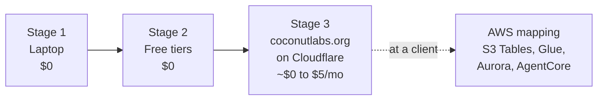
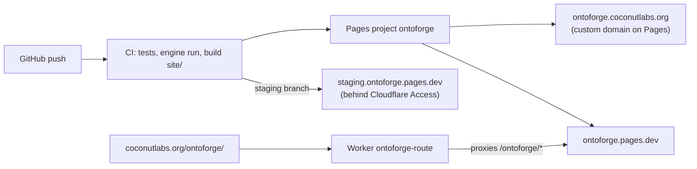

# Deploying OntoForge, cheapest first



## Stage 1: laptop

```bash
pip install -e ".[dev]" && ontoforge run --pack all && make demo
```

Iceberg catalog is SQLite, the warehouse is a local folder, the ontology store is a DuckDB file,
agent checkpoints are SQLite, the LLM is offline. Nothing to pay for.

## Stage 2: free tiers

| Piece | Free option | How |
|---|---|---|
| Public site | Cloudflare Pages | `make site && npx wrangler pages deploy site --project-name ontoforge` (or the CI job) |
| Narration LLM | Workers AI (daily free allocation) | `ONTOFORGE_LLM=cloudflare CF_ACCOUNT_ID=... CF_API_TOKEN=...` |
| Narration from the browser | Worker in `deploy/worker` | `cd deploy/worker && npx wrangler deploy` |
| Iceberg warehouse | R2 (10 GB free, no egress fees) | point PyIceberg at R2's S3 endpoint, or use R2 Data Catalog |
| Audit log | D1 (SQLite) | mirror `audit_log` rows; the hash chain makes tampering visible |
| Heavier SQL | MotherDuck free tier | DuckDB SQL runs unchanged |
| Postgres ontology store | Neon free tier | if you outgrow DuckDB |
| CI | GitHub Actions | `.github/workflows/ci.yml` runs every eval on every push |

## Stage 3: coconutlabs.org, two addresses for one site



The site uses only relative links, so one build serves both addresses.

| Address | How it is served | Set up once |
|---|---|---|
| `ontoforge.coconutlabs.org` | Pages custom domain | Pages, project `ontoforge`, Custom domains, add the subdomain. Cloudflare creates the DNS record. |
| `coconutlabs.org/ontoforge/` | Worker `ontoforge-route` on route `coconutlabs.org/ontoforge*` | `cd deploy/route-worker && npx wrangler deploy`. `coconutlabs.org` must be a zone on the same account. |
| `staging.ontoforge.pages.dev` | Pages branch preview for `staging` | Zero Trust, Access, add an application for that hostname with a one-time PIN to your email. |
| PR previews | Pages branch previews | Automatic from CI. |

Steps, in order:

1. `coconutlabs.org` on Cloudflare DNS (Websites, Add a site, switch nameservers at the registrar).
2. Create the Pages project once: `npx wrangler pages project create ontoforge --production-branch main`.
3. First deploy from a laptop: `make site && npx wrangler pages deploy site --project-name ontoforge --branch main`.
4. Add the custom domain `ontoforge.coconutlabs.org` to the project.
5. Deploy the route Worker: `cd deploy/route-worker && node test.mjs && npx wrangler deploy`. After the subdomain is live you can point `ORIGIN` at it.
6. GitHub secrets `CLOUDFLARE_API_TOKEN` (Pages edit, Workers edit, Zone read) and `CLOUDFLARE_ACCOUNT_ID`. From then on, `main` deploys production, `staging` deploys staging, and PRs get previews.

Media: the rendered MP4s live in `media/` in the repo (about 40 MB total, each under the 25 MB Pages file limit). Re-render with `make media` when a film changes.

The Python engine (LangGraph, PyIceberg, DuckDB) does not run inside a Worker. The live site serves
the snapshot the engine exported, which is the right tradeoff for a free demo. For live runs later,
put the API (`ontoforge serve`) on a small container (Fly.io or a Cloudflare Container) at
`api.ontoforge.coconutlabs.org`, and keep Pages for the UI.

The narration Worker in `deploy/worker` is optional and separate from the site.

## At a client: AWS

| OntoForge locally | AWS |
|---|---|
| landing folder | S3 raw zone, Transfer Family for mainframe drops |
| PyIceberg + SQLite catalog | S3 Tables (Iceberg) + Glue Data Catalog |
| DuckDB SQL models | Athena or Glue Spark |
| quality checks + WAP | Glue Data Quality, Iceberg branches |
| ontology store (DuckDB) | Aurora Postgres, audit to S3 Object Lock |
| policy engine | Amazon Verified Permissions / AgentCore Policy (Cedar) |
| LangGraph agent + MCP | Bedrock AgentCore Runtime + Gateway |
| traces JSONL | CloudWatch / X-Ray via OpenTelemetry |
