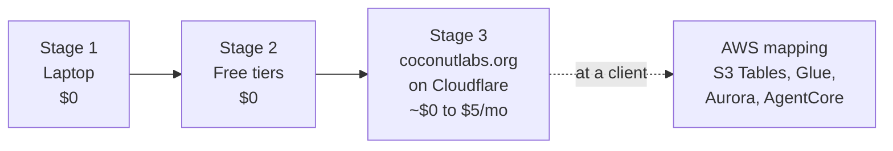
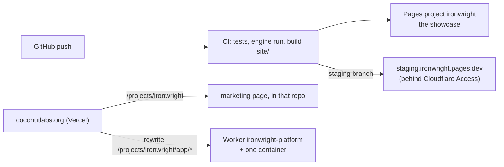

# Deploying Ironwright, cheapest first



## Stage 1: laptop

```bash
pip install -e ".[dev]" && ironwright run --pack all && make demo
```

Iceberg catalog is SQLite, the warehouse is a local folder, the ontology store is a DuckDB file,
agent checkpoints are SQLite, the LLM is offline. Nothing to pay for.

## Stage 2: free tiers

| Piece | Free option | How |
|---|---|---|
| Public site | Cloudflare Pages | `make site && npx wrangler pages deploy site --project-name ironwright` (or the CI job) |
| Narration LLM | Workers AI (daily free allocation) | `IRONWRIGHT_LLM=cloudflare CF_ACCOUNT_ID=... CF_API_TOKEN=...` |
| Narration from the browser | Worker in `deploy/worker` | `cd deploy/worker && npx wrangler deploy` |
| Iceberg warehouse | R2 (10 GB free, no egress fees) | point PyIceberg at R2's S3 endpoint, or use R2 Data Catalog |
| Audit log | D1 (SQLite) | mirror `audit_log` rows; the hash chain makes tampering visible |
| Heavier SQL | MotherDuck free tier | DuckDB SQL runs unchanged |
| Postgres ontology store | Neon free tier | if you outgrow DuckDB |
| CI | GitHub Actions | `.github/workflows/ci.yml` runs every eval on every push |

## Stage 3: coconutlabs.org



The coconutlabs.org zone is DNS only and Vercel serves it, so a Worker route on it never fires.
The old route Worker for `coconutlabs.org/ironwright` is gone for that reason. The hosted product
is mounted with a rewrite instead: `deploy/cloudflare/README.md` is the whole runbook.

| Address | How it is served | Set up once |
|---|---|---|
| `coconutlabs.org/projects/ironwright` | a page in the coconutlabs-site repo | nothing here |
| `coconutlabs.org/projects/ironwright/app/` | Vercel rewrite to Worker `ironwright-platform` and its container | `deploy/cloudflare/README.md` |
| `ironwright.pages.dev` | Pages, the static showcase | below |
| `staging.ironwright.pages.dev` | Pages branch preview for `staging` | Zero Trust, Access, add an application for that hostname with a one-time PIN to your email. |
| PR previews | Pages branch previews | Automatic from CI. |

Pages steps, in order:

1. Create the Pages project once: `npx wrangler pages project create ironwright --production-branch main`.
2. First deploy from a laptop: `make site && npx wrangler pages deploy site --project-name ironwright --branch main`.
3. GitHub secrets `CLOUDFLARE_API_TOKEN` (Pages edit, Workers edit) and `CLOUDFLARE_ACCOUNT_ID`. From then on, `main` deploys production, `staging` deploys staging, and PRs get previews.

Media: the rendered MP4s live in `media/` in the repo (about 40 MB total, each under the 25 MB Pages file limit). Re-render with `make media` when a film changes.

The Python engine (LangGraph, PyIceberg, DuckDB) does not run inside a Worker. The showcase serves
the snapshot the engine exported. The live product runs the engine in a Cloudflare Container behind
the `ironwright-platform` Worker, mounted under the path above.

The narration Worker in `deploy/worker` is optional and separate from the site.

## At a client: AWS

| Ironwright locally | AWS |
|---|---|
| landing folder | S3 raw zone, Transfer Family for mainframe drops |
| PyIceberg + SQLite catalog | S3 Tables (Iceberg) + Glue Data Catalog |
| DuckDB SQL models | Athena or Glue Spark |
| quality checks + WAP | Glue Data Quality, Iceberg branches |
| ontology store (DuckDB) | Aurora Postgres, audit to S3 Object Lock |
| policy engine | Amazon Verified Permissions / AgentCore Policy (Cedar) |
| LangGraph agent + MCP | Bedrock AgentCore Runtime + Gateway |
| traces JSONL | CloudWatch / X-Ray via OpenTelemetry |
