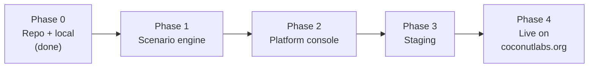
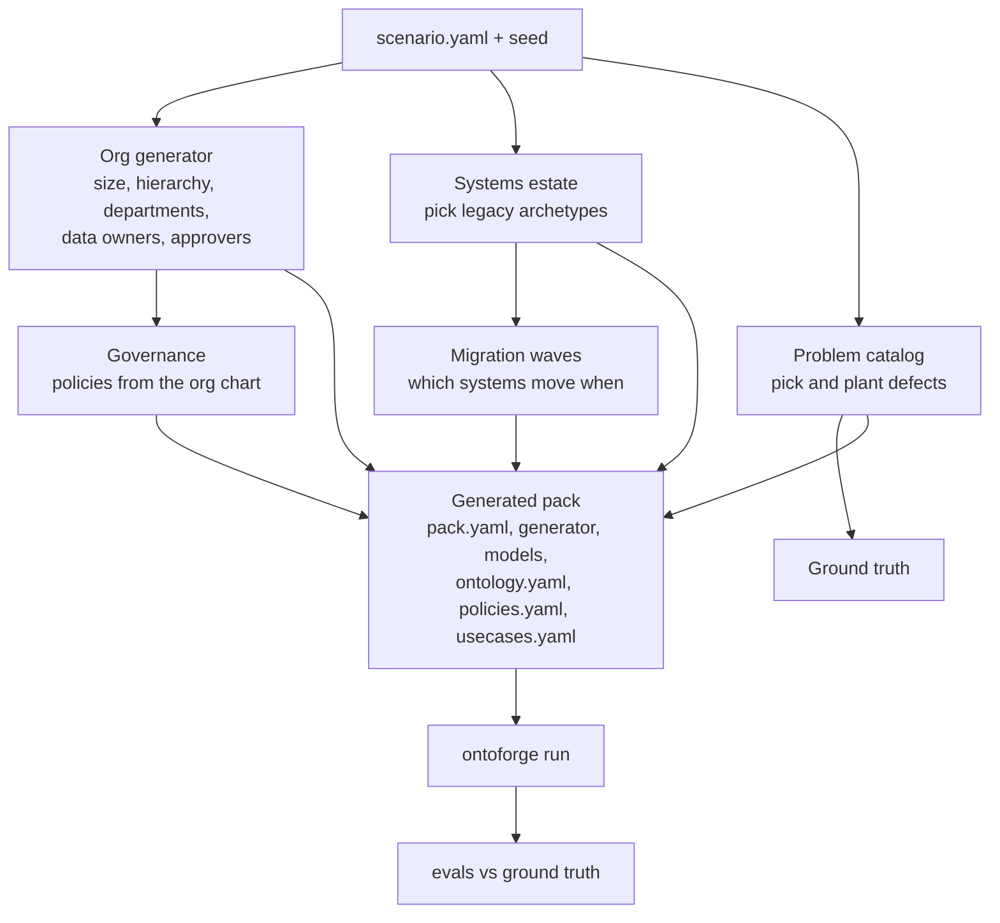
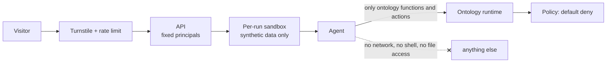
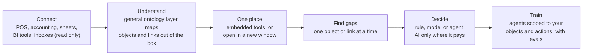

# Roadmap: from four packs to endless scenarios

Today OntoForge has four hand-written packs. The goal is a platform that can generate a believable
company on demand (its org chart, its systems, its problems, its migration and its governance) and
then run the whole modernization story on it, with evals proving every step.

## Phase 0: repo and local (done)

Engine, four packs, web demo, intro video, CI. `pytest -q` is green.

Remaining chores: `git init`, push to GitHub, turn on the CI workflow, add a pre-commit hook for
ruff and pytest.

## Phase 1: the scenario engine

A scenario is one YAML file plus a seed. The engine expands it into a full pack.

### Building blocks

| Block | What it holds | Examples |
|---|---|---|
| Org archetypes | hierarchy templates per industry and size | 16-store regional chain, community bank, 3PL, mutual insurer, hospital network, utility |
| Roles | who owns which data, who approves what | CDO owns Customer, AML ops lead approves closures, store ops approves facings |
| System archetypes | legacy formats with realistic quirks | mainframe fixed width, AS/400 files, Oracle-style ERP tables, Access/Excel trackers, SharePoint lists, SFTP CSV drops, event streams |
| Problem catalog | defects with a planting function and an eval | duplicate entities, missing keys, schema drift, re-sent files, clock skew, test data in reports, legacy logic bugs, late feeds, orphaned references, expired reference data |
| Decisions | the use case the agent takes on | triage, routing, approval, exception handling |
| Migration waves | ordered cutovers with reconciliation rules | wave 1 masters, wave 2 transactions, wave 3 reports |
| Governance | policies generated from roles | default deny, permits per role, forbids for irreversible actions, approval chains following the hierarchy |

The problem catalog should grow out of the case studies in my interview prep: every concept there
(WAP, quarantine vs block, SCD and as-of joins, identity resolution, reconciliation with known
differences, policy as code, checkpointed approvals, groundedness) becomes at least one plantable
problem with an eval.

### Rules for the scenario engine

- Same scenario + same seed gives byte-identical output. Different seeds give different but valid companies.
- Every planted problem lands in ground truth, and the evals must pass on 20 random seeds per archetype before an archetype ships.
- The four existing packs become scenarios in this format, and their evals must not regress.

## Phase 2: platform console

A web app on top of `ontoforge serve`:

- Scenario picker and a "new company" button (archetype, size, seed).
- A stepper that runs the program stage by stage and shows what each stage changed.
- Live trace viewer (the waterfall from the demo, streaming).
- An approvals inbox where the visitor plays the human reviewer.
- An org chart view that shows who owns each object type and who can approve each action.

Stack: keep FastAPI for the API. For the UI, either keep vanilla JS or move to a small Vite + React
app. Decide in Phase 2, not before.

## Phase 3: staging

| Piece | Choice | Why |
|---|---|---|
| UI | Cloudflare Pages preview deployment | free, per-branch URLs |
| Access | Cloudflare Access (one-time PIN to my email) | staging is private |
| API | one small container (Fly.io free allowance or Cloudflare Containers) | LangGraph, DuckDB and PyIceberg need real Python |
| Warehouse | R2 bucket `ontoforge-staging` | S3 compatible, no egress fees |
| Audit mirror | D1 | append only, hash chain verified nightly |
| LLM | Workers AI with a daily budget | cost stays near zero |

## Phase 4: live at ontoforge.coconutlabs.org

- Public read-only: the static showcase and the intro, served by Pages.
- Live runs behind Cloudflare Turnstile, rate limited per IP, using a fresh scenario seed in a sandbox that is thrown away after the run.
- Hard daily caps on LLM tokens and container time. When a cap is hit, the site falls back to the static snapshots.

## Security: secured to these use cases only

The platform is a closed world. It only ever handles companies it generated itself.

1. **Synthetic data only.** No uploads of real data. Any free text a visitor enters (a scenario name, say) is length capped and never reaches a tool.
2. **Closed tool set.** Agents can only call the functions and actions generated from `ontology.yaml`. No web, no shell, no file system, no arbitrary SQL.
3. **Fixed principals.** Visitors act as `user:visitor` with read and approve rights inside their own sandbox. Nobody can act as an agent principal from outside.
4. **Default deny policy, forbids for irreversible actions,** same as today.
5. **Model output never picks an action** and never reaches a tool argument. Prompt injection has nothing to grab.
6. **Budgets and kill switch.** Token, run and container caps per day, plus an env flag that turns live runs off.
7. **Secrets** live in Cloudflare and GitHub secrets, never in the repo. `.env` is git ignored.
8. **Tamper evidence.** Every action is in the hash-chained audit log, mirrored to D1.

## Definition of done for each phase

- `pytest -q` green, plus the new evals for that phase.
- README and `docs/architecture.md` updated with a diagram for anything new.
- A short entry in `docs/build-log.md` for every bug an eval caught.

## Product direction (ideation phase)

The longer-term idea is a general ontology layer that small businesses can point at what they
already run. No backend rebuild, no rework of production systems.

Principles:

- **Learn the business as it is.** Read-only connectors first. The platform maps objects and links before anyone changes a system.
- **Narrow, then act.** Work one object or link at a time, measure the gap (money, time, data quality), and fix the biggest one.
- **AI only where it pays.** Every gap gets a recommendation: a plain rule or automation, a model, or an agent with approval, with its running cost shown before anyone builds it.
- **Your agents, your ontology.** Agents are trained and evaluated on the business's own history, see only the objects in scope, and take only allowed actions.
- **One workspace.** BI dashboards and spreadsheets open embedded next to the objects they describe, or in their own window.

The scenario engine (Phase 1) is how this gets built safely: every connector and gap detector is
proven against generated companies with known ground truth before it touches a real one.

### Governance for regulated industries (healthcare and finance first)

The film's governance section is the target design:

- **Lenses:** one ontology, a different view per role (care manager, billing analyst, compliance officer, agent). Objects show as full, masked, read only or hidden.
- **Field-level masking:** "minimum necessary" by role, computed at read time, not by copying data.
- **Action permissions with separation of duties:** per role, with limits (write-offs under $500), approval rules and "never approve your own".
- **Agent traceability:** every run records what it read, which rule allowed it, model and prompt versions, evidence ids and approvers, linked into the hash-chained audit log.
- **Evidence on demand:** access reviews and control tests generated from the audit log, exportable as an evidence pack.

The current engine already has the building blocks (policy engine, masking by principal, approvals,
traces, audit chain). The work is a role model, a canvas that renders per-role lenses, and evidence reports.

### Other domains

- [Investing pack](investing-pack.md): the same engine pointed at public companies you invest in, with point-in-time data, thesis tracking and proposal-only agents.
