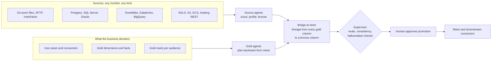
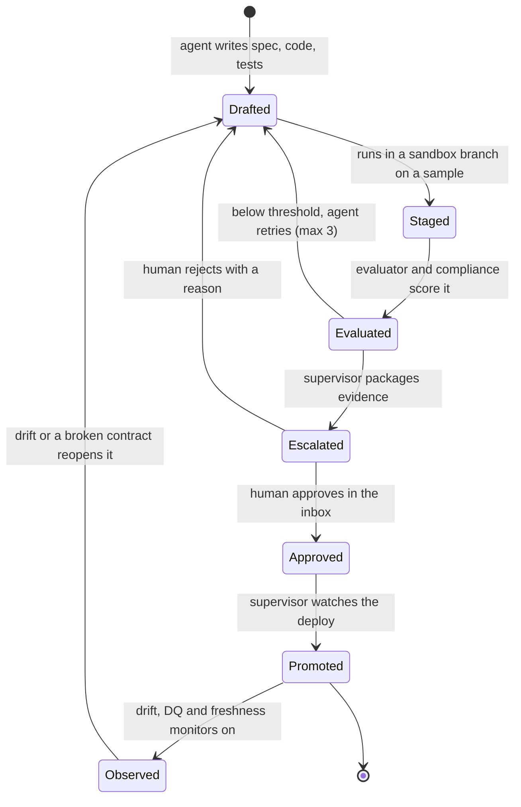
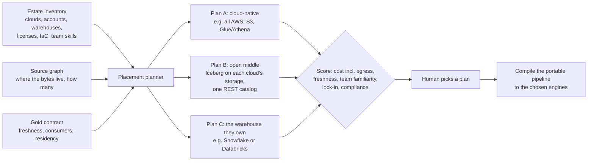

# The agentic bridge: from any source to the gold marts a business asks for

Status: DECIDED 2026-11-06, as the next product layer after the SaaS MVP. The baseline Ironwright
ships today walks one way: upload, profile, silver draft, run, ontology, Ask. The bridge starts from
both ends. The customer tells me where the data lives and what the gold layer and its marts must look
like. Agents build the medallion pipeline that connects the two. A supervisor keeps them honest, and a
human approves every promotion from one layer to the next.

## The idea in one picture



The source side starts working the moment a source is registered. It does not wait for the gold
contract. The gold side works backward from the marts. They meet at silver, where the bridge planner
proves that every column a mart needs traces back to a real bronze column through transforms that pass
their tests.

## What the customer gives me

1. **Sources.** A connection or a drop location per system. Read only. Credentials are stored per
   org (see `docs/enterprise-security.md`). The number and kind of sources does not matter. Each one
   becomes a node in the source graph.
2. **The gold contract**, a `gold.yaml` per workspace:

```yaml
kind: gold-contract
version: 1
use_cases:
  - id: claims-leakage
    audience: claims ops leads
    question: Which open claims are paid above policy limit, by adjuster, weekly?
    freshness: daily by 06:00
    consumer: {type: bi, target: powerbi}
dimensions:
  - name: dim_policy
    grain: one row per policy version
    columns: [{name: policy_no, type: string, key: true}, {name: limit_amount, type: decimal(14,2)}]
facts:
  - name: fct_claim_payment
    grain: one row per payment
    columns: [{name: claim_id, type: string}, {name: paid_amount, type: decimal(14,2)}]
marts:
  - name: mart_claims_leakage
    from: [fct_claim_payment, dim_policy]
    use_case: claims-leakage
    rules: ["paid_amount > limit_amount"]
    access: {roles: [member], masking: {adjuster_email: hash}}
```

If the customer does not know their gold shape yet, a gold agent drafts one from their use case sentences
and the profile of their sources. A human still accepts it before anyone builds against it.

## The agents

| Agent | Starts from | Produces | Never does |
|---|---|---|---|
| Source scout | a registered source | profile, sampled schema, volumes, keys, joins, PII tags | write to the source |
| Bronze builder | the scout's profile | bronze ingestion spec and code, raw contract | change bytes, only record them |
| Contract agent | bronze and silver tables | schema contracts, DQ rules, drift policy | relax a rule a human set |
| Gold planner | `gold.yaml` | the column requirement graph: each mart column, its grain, its aggregation | invent a source column |
| Bridge planner | both graphs | silver model plan with lineage from every gold column to bronze | mark a gap as covered |
| Silver and mart builders | the bridge plan | SQL models and tests per layer | promote their own work |
| Connector agent | an approved mart | the downstream handoff (BI, reverse ETL, API, file drop) | open a new egress path without a permit |
| Evaluator | every staged change | scores: tests, DQ pass rate, contract fit, lineage coverage, cost | pass a change it cannot reproduce |
| Compliance agent | every staged change | PII and purpose checks, residency, retention, masking proof | approve anything |
| Supervisor | all of the above | the plan, the queue, escalations, the stop button | write pipeline code |

Agents talk through one message bus with typed messages (`need`, `offer`, `gap`, `staged`,
`escalate`, `approved`, `promoted`). Every message is a trace span with evidence ids. The supervisor
reads all of it and keeps the run consistent. When two agents disagree, or an agent cites evidence it
never gathered, the supervisor stops that thread and escalates.

## The promotion gate (the heart of it)

The model writes code. It never decides that its code ships. Every move into a layer goes through the
same gate.



- **Drafted.** The agent writes the model, its tests and its contract into a staging branch of the
  workspace. Nothing touches a live table.
- **Staged.** It runs against a sample in an isolated schema. The output goes into the trace.
- **Evaluated.** Deterministic gates decide: tests pass, the contract holds, the DQ pass rate meets the
  threshold, lineage coverage toward the gold columns goes up and never down, cost stays inside budget,
  and the compliance checks pass. An LLM may explain the scores. It never sets them.
- **Escalated.** The sub-agent asks the supervisor to escalate. The supervisor packages one approval
  card: the diff, before and after samples, scores, lineage and the compliance result, all cited by
  evidence id. It goes to the human inbox (the approvals we ship today, extended to pipeline changes).
- **Approved.** A human with the right role approves. Never the requester, never an agent
  (segregation of duties, already enforced by G6).
- **Promoted.** The agent applies the change with the supervisor watching that exact action, using the
  same `act()` order we use today: idempotency, policy, params, preconditions, approval, edits, outbox,
  audit. Nothing irreversible happens before `interrupt()`.
- **Observed.** Monitors watch freshness, drift and DQ. A breach reopens the item and escalates. It does
  not quietly patch production.

This repeats layer by layer: source to bronze, bronze to silver, silver to gold, gold to each mart, and
mart to its downstream connector. The run is done when every use case in `gold.yaml` has a promoted mart
and a working connector.

## Compliance and control

Free agents are the risk. These controls apply to every agent on every layer:

- **Traceability.** Every agent step is a span: model, prompt version, inputs by evidence id, output, cost.
  A run can be replayed.
- **Observability.** A live run board shows each layer, each agent, its queue, its retries and its
  escalations. Debug-level escalation hands a stuck agent's full context to a human.
- **Policy as code.** Per-layer policies decide which agent may touch which table and which data classes
  may cross which layer. For example, PII leaves bronze only masked unless a mart's purpose allows it.
  Default deny.
- **Data minimisation.** Agents see samples and profiles, never full tables, unless a policy allows it.
  Tenant bytes are untrusted at every prompt boundary.
- **Audit.** Promotions, approvals and rejections land in the hash-chained audit log, exportable as
  evidence packs for SOC 2, HIPAA or SOX reviews.

## Scores that tell us the bridge is working

| Score | Meaning |
|---|---|
| Gold coverage | share of gold columns with verified lineage to a source column |
| Contract fit | share of contracts holding on the latest run |
| DQ pass rate | per layer, weighted by row count |
| Human load | approvals per promoted model, and the reject rate |
| Hallucination rate | citations rewritten by the guardrail, plus claims the evaluator could not reproduce |
| Time to first mart | from source registration to the first promoted mart |

## How it fits what already ships

| Exists today | Becomes |
|---|---|
| Profiler and silver draft (F2) | the source scout and the first silver builder |
| Quality gates, write-audit-publish on Iceberg | the evaluator's deterministic gates |
| Ontology propose/accept | the gold planner's object model |
| Approvals with segregation of duties (G6) | the promotion inbox |
| LangGraph agents with `interrupt()` | sub-agents and the supervisor graph |
| Traces, evals, audit chain | traceability and compliance evidence |
| `connectors.py` (local, S3, ADBC, CDC) | the source registry, extended to warehouse connectors |

## Where the pipeline runs (placement)

The bridge decides how data gets from source to mart. Placement decides where that work runs. I treat
placement as its own planner with the same rules: it proposes scored plans, deterministic checks gate
them, and a human picks.



Rules:
1. **Footprint first.** The planner may only use services the org already runs, found in the estate
   inventory. Adding a new tool or SaaS is a separate escalation a human must approve.
2. **Data gravity.** Compute goes where most of the bytes are. Only the smaller side moves, and the
   egress cost is priced into every plan.
3. **Hard constraints before cost.** Residency, PII and contract rules cut plans out before any scoring.
4. **Portable by construction.** Agents write the pipeline once as engine-neutral models (SQL parsed
   and transpiled with SQLGlot, a DAG, contracts, tests). A compiler emits Snowflake, Spark/Databricks,
   BigQuery, Athena/Glue, Synapse/Fabric or DuckDB. `ironwright/engines.py` already proves one model gives
   equal results on two engines. That check becomes the gate for every target.
5. **Open middle for multi-cloud.** When data is spread across clouds, the default sweet spot is Iceberg
   tables on each cloud's own object store with one shared catalog, so every engine the org already owns
   reads the same tables without copies.
6. **Tools are adapters.** Each cloud service or SaaS is an adapter (an MCP server or connector) in a
   capability registry. Policy decides which adapters an agent may call, per layer.
7. **Prove before choosing.** For close calls, run a bake-off on a sample on the top two plans and record
   real cost and time as evidence on the approval card.
8. **Keep re-checking.** A FinOps loop watches billing and usage and proposes a re-placement through the
   same promotion gate when the numbers shift.

Phase B6 (after B4): estate inventory, placement planner with scored plans, the portable compiler for
DuckDB, Snowflake and Spark first, and a sample bake-off. Done when a three-cloud fixture yields three
scored plans, a human picks one, and the same models pass the equal-results check on the chosen engine.

## Phases

| Phase | Delivers | Done when |
|---|---|---|
| B1 Gold contract and backward planner | `gold.yaml` spec, validator, gold planner, the requirement graph and a lineage coverage report on uploaded sources | a fixture with 3 sources and 2 marts shows every gap and every covered column, with tests |
| B2 Promotion gate and supervisor | the state machine above, sandbox staging, evaluator, the escalation inbox, the supervisor graph | a mart goes from draft to promoted only with a human approval, and a failing eval loops back |
| B3 Warehouse sources | read-only connectors for Postgres, Snowflake, Databricks SQL, BigQuery, Iceberg REST, with sampling | the same fixture runs from a Postgres source in CI |
| B4 Marts and downstream connectors | mart builder, BI and file and API handoff, freshness SLAs | a declared use case ends in a working consumer |
| B5 Observe and heal | drift and DQ monitors that reopen items, the run board, human load metrics | a planted drift reopens the right item and escalates |
| B6 Placement planner (after B4) | estate inventory, placement planner with scored plans, the portable compiler for DuckDB, Snowflake and Spark first, and a sample bake-off | a three-cloud fixture yields three scored plans, a human picks one, and the same models pass the equal-results check on the chosen engine |

Every phase keeps the house rules. Evals gate everything. Every planted problem in a generated bridge
workspace has a ground-truth eval. Rules decide promotion. The model drafts and narrates.
