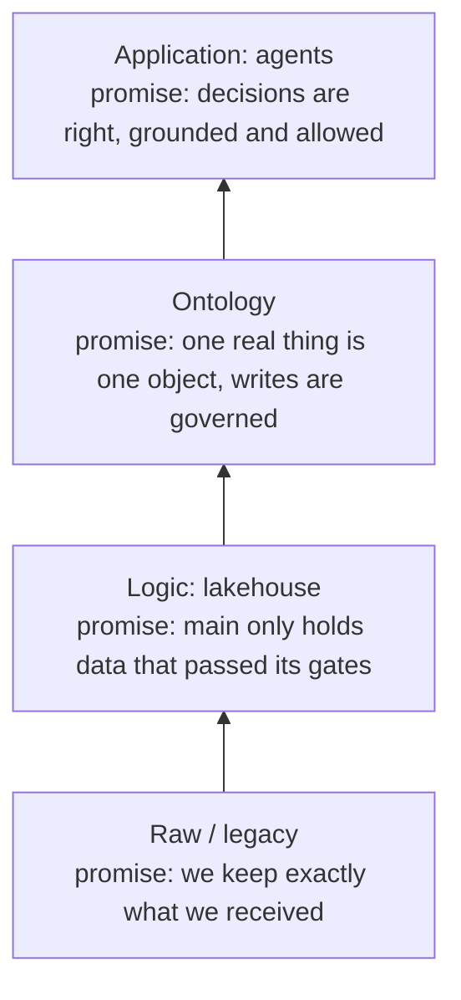
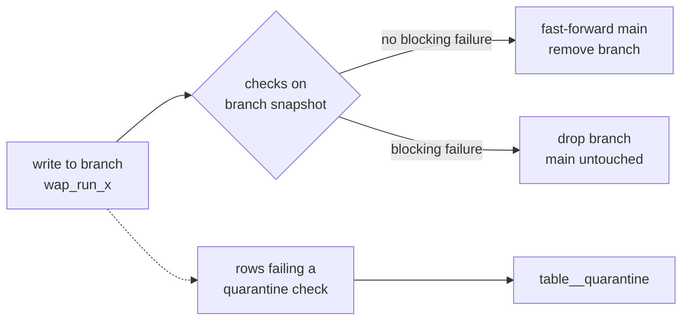
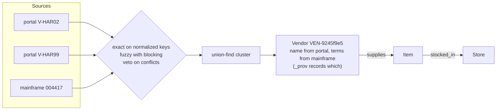
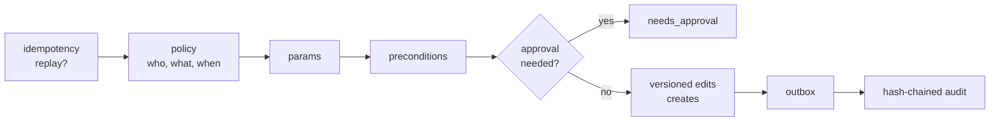
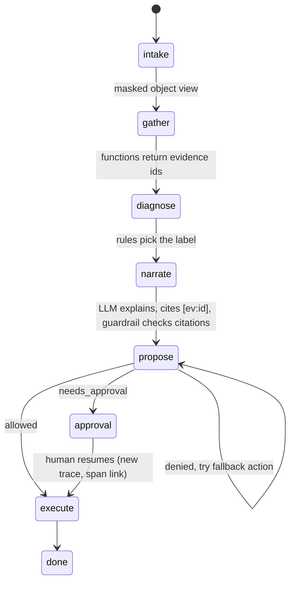
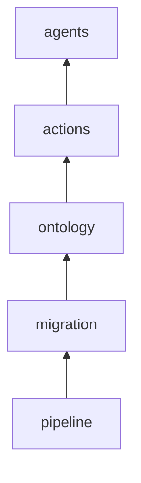

# Architecture

OntoForge has four layers. Each one makes a promise to the layer above it, and each promise has an eval.

## 1. Raw / legacy

Every pack's `generator.py` writes the legacy estate for a fictional company: COBOL style fixed
width masters, old SQLite apps, CSV drops per region, JSONL event streams and the nightly report
the business trusts today. It also writes `_ground_truth.json`: every duplicate vendor, every
bad clock, every out-of-stock pair it planted. That file is how the evals know the right answer.

`legacy.py` reads all four formats and lands **every field as a string**. Typing happens in silver,
where a failed cast is a visible check instead of a silent null.

## 2. Logic layer: Iceberg lakehouse

- **Bronze** keeps every run (`_run_id`, `_source_system`). The `bronze_x` view is the latest run; `bronze_x_all` is history. That is what makes replays and audits possible.
- **Silver** SQL models type, dedupe and conform. Checks are structural (not null, unique, castable) and semantic (a loss can't be reported before it happened).
- **Gold** models are business metrics. Retail's `item_store_daily` uses an ASOF join so each sale meets the planogram that was in effect that day, not today's.
- Each check has a **severity** (`block`, `warn`, `quarantine`) and an **owner**. Quarantine moves bad rows aside so one bad clock doesn't block a whole claims table.

`reconcile.py` then compares the legacy report to the lake. Every difference is matched, within
tolerance, explained by a `known_differences` rule (the old job double counted a re-sent POS file),
or unexplained. Cutover is ready only when unexplained is zero.

## 3. Ontology

`ontology.yaml` defines object types (with one owner each), how to match them, which source wins
for each property, links, functions and actions. The build writes a crosswalk (source key to
object id), a merge log, a review queue for near misses, and the objects themselves.

**Functions** are governed reads: parameterized DuckDB SQL over gold and the ontology, checked by
policy, returning rows plus an evidence id like `stock_signal#1a2b3c4d`.

**Actions** are governed writes, always in this order:

Policy runs first on purpose. An agent that isn't allowed to cancel a shipment should hear
"denied", not a helpful hint about which parameter it got wrong.

The **outbox** worker writes back to the legacy systems with retries. If a system rejects a write,
the worker restores the before image (compensation) and records why.

## 4. Application: agents

- Rules diagnose; the model only narrates. This keeps decisions testable and cheap.
- Nothing irreversible happens before `interrupt()`. State is checkpointed in SQLite, so the human can approve hours later.
- Sensitive fields (`dob`, `holder_name`) are masked unless the principal has `read_sensitive:<Type>`.
- Every node, tool call, function, warehouse query and action is a span. The resume is a new trace linked to the original, which is how it looks in real OTel backends.

The same functions and actions are exposed as a REST API (`X-Principal` header) and as MCP tools
generated from `ontology.yaml`, so any MCP client gets the same governance as the built-in agent.

## Evals

Read bottom up. If the pipeline leaks a blocked row, an agent accuracy score means nothing.
`tests/test_packs_end_to_end.py` runs every pack through every layer, so a regression anywhere
fails CI.
