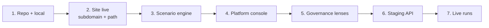

# Kickoff prompts for Claude Code

Paste these one at a time. Each ends with green tests, so you can stop between them.
Prompts 1 and 2 get the site live. Prompts 3 to 7 build the platform.



## 1. Repo and local

```
Read CLAUDE.md, README.md, docs/ROADMAP.md and deploy/README.md. Then:
1. Create a venv, pip install -e ".[dev]" playwright, run `make run` and `pytest -q`. Fix anything that breaks here.
2. git init, first commit (media/ included), create a private GitHub repo named ironwright with `gh repo create`, push.
3. Add ruff and a pre-commit hook for ruff and pytest.
4. Confirm the CI workflow runs green on GitHub (the deploy steps skip until secrets exist).
Tell me what you changed and anything you could not do.
```

## 2. Get the site live at both addresses

```
Follow deploy/README.md, "Stage 3". Build the site with `make site`, preview it with `make preview`
and check every page at both / and under a /ironwright/ prefix (serve site/ from a folder named
ironwright to simulate the path). Then walk me through each Cloudflare step I must do by hand
(DNS, Pages project, custom domain ironwright.coconutlabs.org, route Worker for
coconutlabs.org/ironwright, GitHub secrets). Run the wrangler commands yourself once I confirm I am
logged in. Stop and ask before anything that costs money. Finish by curling both addresses and
showing me the status codes.
```

## 3. Scenario engine

```
Implement Phase 1 from docs/ROADMAP.md. Start with a plan in docs/scenario-engine.md (with a mermaid
diagram) and wait for my OK before writing code. Constraints: same scenario plus seed is byte
identical; every planted problem goes to ground truth and has an eval; convert the four existing
packs into scenarios without any eval regression; add a regional hospital network archetype and make
evals pass on 20 random seeds. Regenerate the use-case films for the new archetype.
```

## 4. Platform console

```
Implement Phase 2 from docs/ROADMAP.md as a new site route /app/: scenario picker, stage stepper,
streaming trace viewer, approvals inbox and org chart, on top of `ironwright serve`. Keep the console
look (Geist, flat panels, 1px borders, 6px corners, one blue accent). For the static site, the app
must also run read-only from exported snapshots. Add API tests and a Playwright smoke test.
```

## 5. Governance lenses

```
Implement "Governance for regulated industries" from docs/ROADMAP.md: a role model, per-role lenses
on the canvas (full, masked, read only, hidden), field masking at read time, action permissions with
separation of duties, agent run records with model and prompt versions, and an evidence-pack export.
Use the healthcare scenario from web/films/specs/healthcare.json as the first real pack. Tests must
prove every control.
```

## 6. Staging API

```
Implement Phase 3: Dockerfile for the API, deploy to the container host I choose at
api-staging.ironwright.coconutlabs.org behind Cloudflare Access, R2 warehouse option for PyIceberg,
and point /app/ on the staging site at it. Write manual steps into deploy/STAGING.md.
```

## 7. Live runs

```
Implement Phase 4 and the security section of docs/ROADMAP.md: Turnstile on live runs, per-IP rate
limits, daily token and run budgets with a kill switch, per-run sandboxes, and a fallback to static
snapshots when a cap is hit. Add tests that prove each control works.
```
