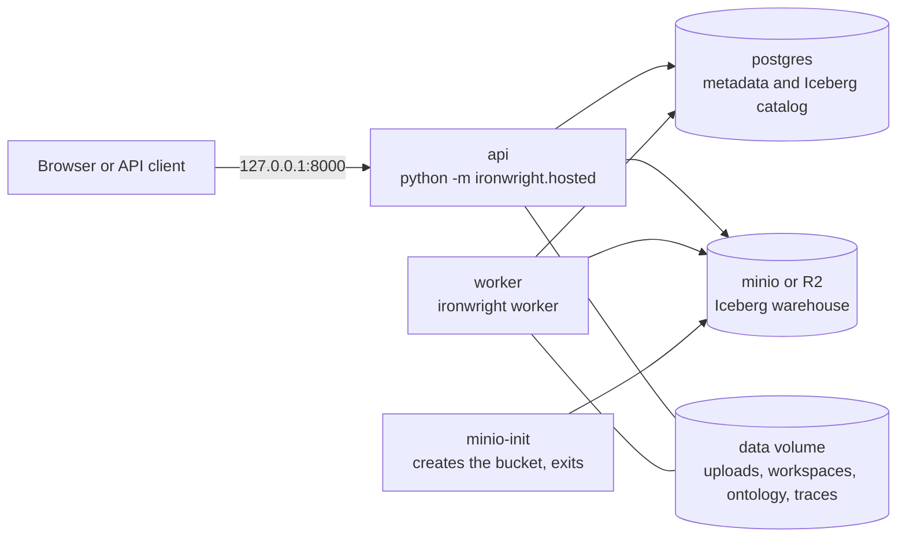

# Deploying the hosted stack

This page takes you from a clean machine to a running stack. The storage and tenancy rules it
follows are in `saas-mvp.md`.



One image runs every process. The image holds no settings and no secrets.

## Run it on one machine

You need Docker with Compose. From the repo root:

```bash
docker compose -f deploy/compose.yaml up --build
```

Then check it:

```bash
curl -s http://127.0.0.1:8000/healthz
curl -s http://127.0.0.1:8000/readyz
```

`/readyz` returns `{"status":"ready","checks":{"db":"ok","object_store":"ok"}}` when the stack is up.
The console is at `http://127.0.0.1:8000/console/`.

The door is closed by default, so you need an account:

```bash
docker compose -f deploy/compose.yaml exec api ironwright auth-set
```

To walk the whole stack with the smoke script, start it open. This is for tests and for your own
machine only.

```bash
IRONWRIGHT_DEV_OPEN=1 docker compose -f deploy/compose.yaml up --build -d
python deploy/hosted_smoke.py --base http://127.0.0.1:8000
```

`docker compose -f deploy/compose.yaml down -v` stops it and deletes its volumes.

The compose file publishes the API on loopback only. Postgres and MinIO are not published at all.
Their default passwords are fine on that private network and nowhere else.

## Health routes

| Route | Means | Failure |
|---|---|---|
| `GET /healthz` | The process is up. It checks nothing else. | No answer |
| `GET /readyz` | The database and the object store both answered. | 503, naming the failed check and nothing more |

Neither route needs a session. Both answer before the app sees the request, and every other route
stays behind the session gate.

## Settings

Every setting comes from the environment. A test fails if the engine reads an `IRONWRIGHT_` setting
that is not in this table.

### Serving

| Variable | Default | What it does |
|---|---|---|
| `IRONWRIGHT_ENV` | `local` | `local`, `staging` or `prod`. On `staging` and `prod` the server refuses to start with `IRONWRIGHT_DEV_OPEN=1`. |
| `IRONWRIGHT_HOST` | `127.0.0.1` | Bind address. A container must set `0.0.0.0` to be reachable, and I make you say so. The image does not set it. |
| `IRONWRIGHT_PORT` | `PORT`, then `8000` | Bind port. |
| `PORT` | none | The port a platform like Railway injects. |
| `IRONWRIGHT_DEV_OPEN` | off | `1` removes the login. Tests and demo-check only. Never on a reachable server. |
| `IRONWRIGHT_KILL_SWITCH` | off | `1` turns off Ask and actions (arrives with S5). |

### Storage

| Variable | Default | What it does |
|---|---|---|
| `IRONWRIGHT_DATA` | `./data`, `/data` in the image | Root for uploads, workspaces, ontology stores and traces. This must be a persistent volume. |
| `IRONWRIGHT_DB_URL` | `sqlite:///<data>/meta.sqlite` | Metadata store. It also holds the Iceberg catalog when the lake is on object storage. `postgres://` URLs are accepted as they are. |
| `IRONWRIGHT_LAKE_URI` | none | `s3://bucket/prefix` puts the Iceberg warehouse on object storage. Unset means local disk. |
| `IRONWRIGHT_S3_ENDPOINT` | none | Endpoint for MinIO or R2. Unset means AWS. |
| `AWS_ACCESS_KEY_ID` | none | Secret. Object store key. |
| `AWS_SECRET_ACCESS_KEY` | none | Secret. Object store secret. |
| `AWS_REGION` | `us-east-1` | Object store region. |
| `IRONWRIGHT_L1_MAX_FILE_BYTES` | see `connectors.py` | Largest local file accepted. |
| `IRONWRIGHT_L1_MAX_FILES` | see `connectors.py` | Most local files accepted. |

The warehouse layout on object storage is fixed by contract 2:

```
<prefix>/tenants/<org_id>/workspaces/<ws>/lake
<prefix>/demo/<pack>/lake
```

### Jobs and models

| Variable | Default | What it does |
|---|---|---|
| `IRONWRIGHT_WORKERS` | set by T4 | Global cap on running jobs (arrives with T4). |
| `IRONWRIGHT_LLM` | `offline` | `offline`, `ollama`, `cloudflare`, `anthropic` or `openai`. |
| `IRONWRIGHT_LLM_MODEL` | per provider | Model name. |
| `IRONWRIGHT_OLLAMA_URL` | `http://localhost:11434` | Ollama address. |
| `IRONWRIGHT_PRINCIPAL` | `agent:mcp-client` | The identity the MCP server acts as. |
| `ANTHROPIC_API_KEY` | none | Secret. Needed for `anthropic`. |
| `OPENAI_API_KEY` | none | Secret. Needed for `openai`. |
| `CF_ACCOUNT_ID` | none | Needed for `cloudflare`. |
| `CF_API_TOKEN` | none | Secret. Needed for `cloudflare`. |
| `POSTGRES_URI` | none | Server for the cross engine check and BI mirror routes. Separate from the metadata store. |

### Compose only

| Variable | Default | What it does |
|---|---|---|
| `POSTGRES_PASSWORD` | `ironwright-local` | Password for the compose Postgres. |
| `MINIO_ROOT_USER` | `ironwright` | Key for the compose MinIO. |
| `MINIO_ROOT_PASSWORD` | `ironwright-local` | Secret for the compose MinIO. |

## Staging on Railway

I have not deployed this yet. The config is in `deploy/railway/railway.toml`, and these are the steps
I expect to work. Confirm each one on the first deploy.

1. Create a project with a Postgres database and one service from this repo.
2. In the service settings, set the config file path to `deploy/railway/railway.toml`.
3. Attach a volume to the service, mounted at `/data`.
4. Create an R2 bucket and an API token for it.
5. Set these on the service:

   | Variable | Value |
   |---|---|
   | `IRONWRIGHT_ENV` | `staging` |
   | `IRONWRIGHT_HOST` | `0.0.0.0` |
   | `IRONWRIGHT_DB_URL` | `${{Postgres.DATABASE_URL}}` |
   | `IRONWRIGHT_LAKE_URI` | `s3://<bucket>/staging` |
   | `IRONWRIGHT_S3_ENDPOINT` | `https://<account>.r2.cloudflarestorage.com` |
   | `AWS_ACCESS_KEY_ID`, `AWS_SECRET_ACCESS_KEY` | the R2 token |
   | `AWS_REGION` | `auto` |
   | `RAILWAY_RUN_UID` | `0` |

Then deploy with one command from the repo root:

```bash
railway up --service ironwright --detach
```

Three things to know before you rely on it:

- **One service, not two.** A Railway volume mounts on a single service, and the API and the worker
  both need the same data root. So staging runs both in one service until that state moves off the
  disk. Once `ironwright worker` exists, the start command has to launch both.
- **It runs as root.** Railway volumes need `RAILWAY_RUN_UID=0` for an image with a non-root user.
  Compose keeps the non-root user. Railway gives it up.
- **R2 is untested.** CI proves the lake on MinIO. R2 speaks the same API, but no test has run on it.

## What CI proves

The `hosted-smoke` job builds the image, boots the stack and runs `deploy/hosted_smoke.py`. Then it
checks that the catalog rows are in Postgres, the parquet files are in the bucket, none are on the
disk, and the API is not root. It also runs `tests/test_hosted.py` against a real MinIO and Postgres
and fails if any test skips.

Those object store tests skip without `IRONWRIGHT_TEST_S3_ENDPOINT`. To run them locally, start any
S3 endpoint:

```bash
uvx --from 'moto[server]' moto_server -H 127.0.0.1 -p 5555
IRONWRIGHT_TEST_S3_ENDPOINT=http://127.0.0.1:5555 pytest -q tests/test_hosted.py
```
