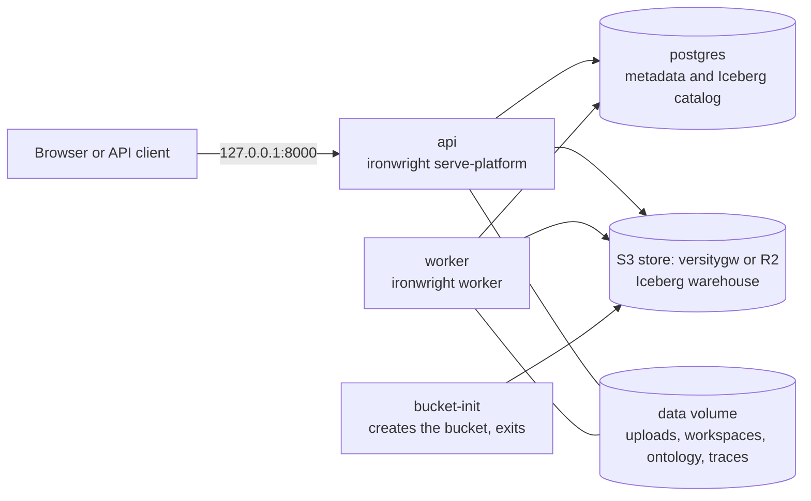
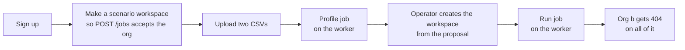

# Deploying the hosted stack

This page takes you from a clean machine to a running stack. The storage and tenancy rules it
follows are in `saas-mvp.md`.



One image runs every process. The image holds no settings and no secrets.

## Run it on one machine

You need Docker with Compose. From the repo root:

```bash
docker compose -f deploy/compose.yaml up --build
```

Then check it:

```bash
curl -s http://127.0.0.1:8000/healthz
curl -s http://127.0.0.1:8000/readyz
```

`/readyz` returns `{"status":"ready","checks":{"db":"ok","object_store":"ok"}}` when the stack is up.
The console is at `http://127.0.0.1:8000/console/`.

The door is closed by default. Sign up to make an org and get a token:

```bash
curl -s http://127.0.0.1:8000/auth/signup -H 'content-type: application/json' \
  -d '{"email":"me@example.com","password":"at-least-8-chars","org_name":"Acme"}'
```

The four demo packs are read only to every org, so an operator builds them from inside the container.
Then the smoke script walks the stack as two signed-up orgs. It refuses a server with the door open.
Run it from the repo root, because it reads its upload from `tests/fixtures/ingest/join/`.

```bash
docker compose -f deploy/compose.yaml exec api ironwright run --pack all
python deploy/hosted_smoke.py --base http://127.0.0.1:8000
```

`docker compose -f deploy/compose.yaml down -v` stops it and deletes its volumes.

The compose file publishes the API on loopback only. Postgres and the object store are not published at all.
Their default passwords are fine on that private network and nowhere else.

## The walk the smoke script takes



Two of those steps are not what a tenant will finally do:

- **Creating the workspace.** No route creates a tenant workspace yet. The script runs T2's
  `create_workspace` inside the API container, and accepts the proposal as it stands.
- **The scenario workspace.** `POST /jobs` only takes a workspace the org can already see, and an org
  has none before its first profile. So the script makes one first.

Ask is not in the walk yet. It comes after wave 2, because the read and Ask routes only know the demo
packs today. That is also why the script reads the run's evals from the job, not from `/reports`.

## Health routes

| Route | Means | Failure |
|---|---|---|
| `GET /healthz` | The process is up. It checks nothing else. | No answer |
| `GET /readyz` | The database and the object store both answered. | 503, naming the failed check and nothing more |

Neither route needs a session. Both answer before the routes run, and every other route stays
behind the session gate. They carry the same security headers as everything else.

## How this differs from `ironwright platform`

`ironwright platform` is the local server and takes its bind from flags. `ironwright serve-platform`
is the hosted one. It takes its bind from the environment and refuses those flags, adds the health
routes, and refuses `IRONWRIGHT_DEV_OPEN=1` on staging and prod. Both run S5's hardening and need
the same two keys to leave loopback.

## Settings

Every setting comes from the environment. A test fails if the engine reads an `IRONWRIGHT_` setting
that is not in this table.

### Serving

| Variable | Default | What it does |
|---|---|---|
| `IRONWRIGHT_ENV` | `local` | `local`, `staging` or `prod`. On `staging` and `prod` the server refuses to start with `IRONWRIGHT_DEV_OPEN=1`, or without `IRONWRIGHT_SECRET_KEY`. |
| `IRONWRIGHT_HOST` | `127.0.0.1` | Bind address for `serve-platform`. A container must set `0.0.0.0` to be reachable. The image does not set it. |
| `IRONWRIGHT_I_KNOW_THIS_IS_EXPOSED` | off | `1` is required for any host that is not loopback. Same two keys as the `--host` and `--i-know-this-is-exposed` flags on `platform`. |
| `IRONWRIGHT_PORT` | `PORT`, then `8000` | Bind port. |
| `PORT` | none | The port a platform like Railway injects. |
| `IRONWRIGHT_DEV_OPEN` | off | `1` removes the login. Tests and demo-check only. Never on a reachable server. |
| `IRONWRIGHT_KILL_SWITCH` | off | `1` turns off Ask and actions. Reads and health routes stay up. |
| `IRONWRIGHT_CONSOLE_ORIGIN` | none | One origin allowed to call the API from a browser. Unset means same-origin only. |

### Storage

| Variable | Default | What it does |
|---|---|---|
| `IRONWRIGHT_DATA` | `./data`, `/data` in the image | Root for uploads, workspaces, ontology stores and traces. This must be a persistent volume. |
| `IRONWRIGHT_DB_URL` | `sqlite:///<data>/meta.sqlite` | Metadata store. It also holds the Iceberg catalog when the lake is on object storage. `postgres://` URLs are accepted as they are. |
| `IRONWRIGHT_LAKE_URI` | none | `s3://bucket/prefix` puts the Iceberg warehouse on object storage. Unset means local disk. |
| `IRONWRIGHT_S3_ENDPOINT` | none | Endpoint for an S3 store like R2 or the compose gateway. Unset means AWS. |
| `AWS_ACCESS_KEY_ID` | none | Secret. Object store key. |
| `AWS_SECRET_ACCESS_KEY` | none | Secret. Object store secret. |
| `AWS_REGION` | `us-east-1` | Object store region. |
| `IRONWRIGHT_L1_MAX_FILE_BYTES` | see `connectors.py` | Largest local file accepted. |
| `IRONWRIGHT_L1_MAX_FILES` | see `connectors.py` | Most local files accepted. |

The warehouse layout on object storage is fixed by contract 2:

```
<prefix>/tenants/<org_id>/workspaces/<ws>/lake
<prefix>/demo/<pack>/lake
```

### Jobs and models

| Variable | Default | What it does |
|---|---|---|
| `IRONWRIGHT_WORKERS` | `2` | Global cap on running jobs, across every worker process. |
| `IRONWRIGHT_RUNS_WAIT` | `1` | `0` leaves every run to the worker. With `1`, `POST /workspaces/{name}/runs` drives the job inside the API, which only suits a local install. Compose sets `0`. |
| `IRONWRIGHT_JOB_HEARTBEAT_SECONDS` | `10` | How often a worker says it is alive. |
| `IRONWRIGHT_JOB_HEARTBEAT_TIMEOUT` | `60` | How long a silent job waits before it is queued again. |
| `IRONWRIGHT_LLM` | `offline` | `offline`, `ollama`, `cloudflare`, `anthropic` or `openai`. |
| `IRONWRIGHT_LLM_MODEL` | per provider | Model name. |
| `IRONWRIGHT_OLLAMA_URL` | `http://localhost:11434` | Ollama address. |
| `IRONWRIGHT_PRINCIPAL` | `agent:mcp-client` | The identity the MCP server acts as. |
| `IRONWRIGHT_SECRET_KEY` | none | Secret. The Fernet key that seals each org's own model key. Required on `staging` and `prod`. A malformed one stops the server anywhere. Make one with `python -c "from cryptography.fernet import Fernet; print(Fernet.generate_key().decode())"`. Changing it makes stored keys unreadable, and those orgs get the template until an admin stores theirs again. |
| `ANTHROPIC_API_KEY` | none | Secret. Needed for `anthropic`. |
| `OPENAI_API_KEY` | none | Secret. Needed for `openai`. |
| `CF_ACCOUNT_ID` | none | Needed for `cloudflare`. |
| `CF_API_TOKEN` | none | Secret. Needed for `cloudflare`. |
| `POSTGRES_URI` | none | Server for the cross engine check and BI mirror routes. Separate from the metadata store. |

### Compose only

| Variable | Default | What it does |
|---|---|---|
| `POSTGRES_PASSWORD` | `ironwright-local` | Password for the compose Postgres. |
| `OBJECTSTORE_ACCESS_KEY` | `ironwright` | Key for the compose object store. |
| `OBJECTSTORE_SECRET_KEY` | `ironwright-local` | Secret for the compose object store. |

## Why the compose store is not MinIO

The contract names MinIO, but `dl.min.io` now answers 410 and says the open-source server and client
are archived and get no security updates. The official images no longer pull anonymously from Docker
Hub, Quay or GHCR. So compose runs Versity's S3 gateway (`versity/versitygw`) on a plain directory.
The engine only knows `IRONWRIGHT_S3_ENDPOINT`, so any S3 store fits.

## Staging on Railway

I have not deployed this yet. The config is in `deploy/railway/railway.toml`, and these are the steps
I expect to work. Confirm each one on the first deploy.

1. Create a project with a Postgres database and one service from this repo.
2. In the service settings, set the config file path to `deploy/railway/railway.toml`.
3. Attach a volume to the service, mounted at `/data`.
4. Create an R2 bucket and an API token for it.
5. Set these on the service:

   | Variable | Value |
   |---|---|
   | `IRONWRIGHT_ENV` | `staging` |
   | `IRONWRIGHT_HOST` | `0.0.0.0` |
   | `IRONWRIGHT_I_KNOW_THIS_IS_EXPOSED` | `1` |
   | `IRONWRIGHT_RUNS_WAIT` | `0` |
   | `IRONWRIGHT_SECRET_KEY` | a Fernet key you generate once and keep |
   | `IRONWRIGHT_DB_URL` | `${{Postgres.DATABASE_URL}}` |
   | `IRONWRIGHT_LAKE_URI` | `s3://<bucket>/staging` |
   | `IRONWRIGHT_S3_ENDPOINT` | `https://<account>.r2.cloudflarestorage.com` |
   | `AWS_ACCESS_KEY_ID`, `AWS_SECRET_ACCESS_KEY` | the R2 token |
   | `AWS_REGION` | `auto` |
   | `RAILWAY_RUN_UID` | `0` |

Then deploy with one command from the repo root:

```bash
railway up --service ironwright --detach
```

Four things to know before you rely on it:

- **One service, not two.** A Railway volume mounts on a single service, and the API and the worker
  both need the same data root. So the start command launches both until that state moves off the
  disk. If either one dies, the service exits and Railway restarts both. No test has run that command.
- **It runs as root.** Railway volumes need `RAILWAY_RUN_UID=0` for an image with a non-root user.
  Compose keeps the non-root user. Railway gives it up.
- **The login limit sees one address.** S5 keys it on the socket and does not trust forwarded headers.
  Behind Railway's proxy every client shares that address, so one person guessing passwords can lock
  everyone out of login for the window. The fix needs a trusted proxy setting, which I have not added.
- **R2 is untested.** CI proves the lake on the compose gateway. R2 speaks the same API, but no test has run on it.

## What CI proves

The `hosted-smoke` job builds the image, boots the stack with the door closed, builds the demo packs
and runs `deploy/hosted_smoke.py`. That reads a demo pack, has a demo pack write refused, walks a tenant
from upload to a green run on the worker, and has a second org fail to see any of it. Then the job
checks, for a demo pack and for that tenant, that the catalog rows are in Postgres and the parquet files
are in the bucket. It checks that no parquet is on the disk, and that the API and the worker are not
root. It also runs `tests/test_hosted.py` against that same gateway and a real Postgres
and fails if any test skips.

Those object store tests skip without `IRONWRIGHT_TEST_S3_ENDPOINT`. To run them locally, start any
S3 endpoint:

```bash
uvx --from 'moto[server]' moto_server -H 127.0.0.1 -p 5555
IRONWRIGHT_TEST_S3_ENDPOINT=http://127.0.0.1:5555 pytest -q tests/test_hosted.py
```
