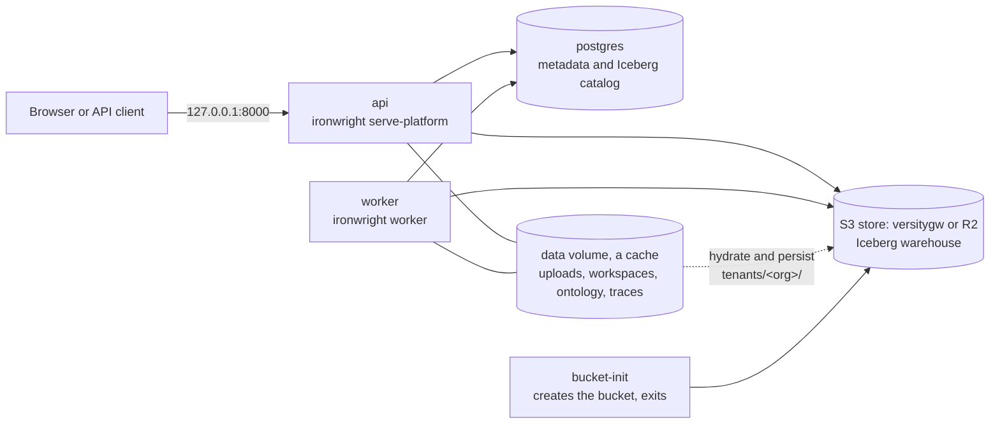
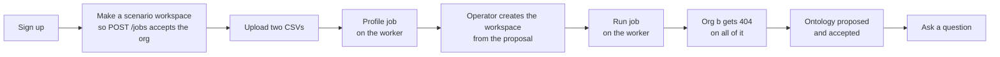
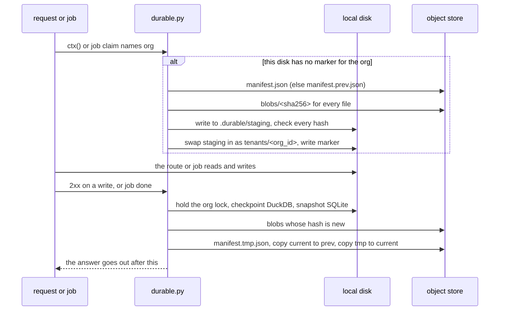
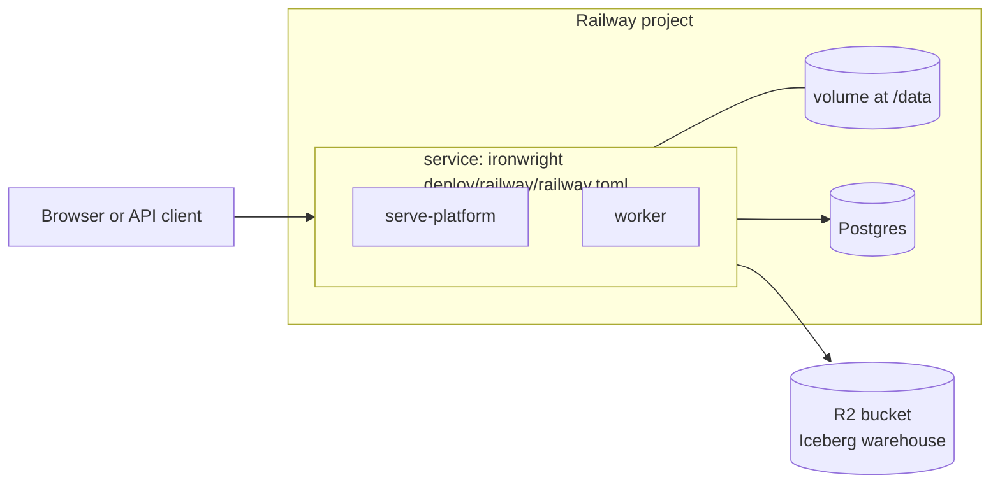
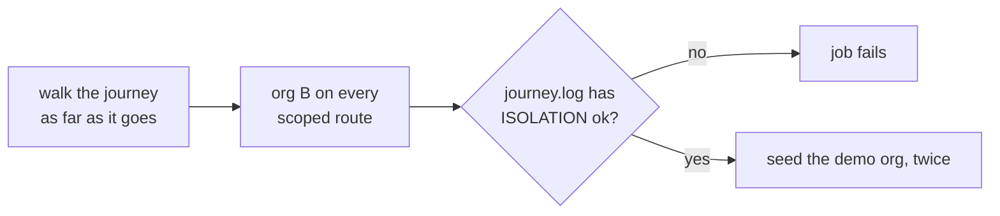

# Deploying the hosted stack

This page takes you from a clean machine to a running stack. The storage and tenancy rules it
follows are in `saas-mvp.md`.



One image runs every process. The image holds no settings and no secrets.

## Run it on one machine

You need Docker with Compose. From the repo root:

```bash
docker compose -f deploy/compose.yaml up --build
```

Then check it:

```bash
curl -s http://127.0.0.1:8000/healthz
curl -s http://127.0.0.1:8000/readyz
```

`/readyz` returns `{"status":"ready","checks":{"db":"ok","object_store":"ok"}}` when the stack is up.
The console is at `http://127.0.0.1:8000/console/`.

The door is closed by default. Sign up to make an org and get a token:

```bash
curl -s http://127.0.0.1:8000/auth/signup -H 'content-type: application/json' \
  -d '{"email":"me@example.com","password":"at-least-8-chars","org_name":"Acme"}'
```

The four demo packs are read only to every org, so an operator builds them from inside the container.
Then the smoke script walks the stack as two signed-up orgs. It refuses a server with the door open.
Run it from the repo root, because it reads its upload from `tests/fixtures/ingest/join/`.

```bash
docker compose -f deploy/compose.yaml exec api ironwright run --pack all
python deploy/hosted_smoke.py --base http://127.0.0.1:8000
```

`docker compose -f deploy/compose.yaml down -v` stops it and deletes its volumes.

The compose file publishes the API on loopback only. Postgres and the object store are not published at all.
Their default passwords are fine on that private network and nowhere else.

## The walk the smoke script takes



Two of those steps are not what a tenant will finally do:

- **Creating the workspace.** No route creates a tenant workspace yet. The script runs T2's
  `create_workspace` inside the API container, and accepts the proposal as it stands.
- **The scenario workspace.** `POST /jobs` only takes a workspace the org can already see, and an org
  has none before its first profile. So the script makes one first.

The script reads the run's evals from the job, not from `/reports`, because `/reports` only knows the
demo packs. With `--state FILE` it also saves what org a can see, and `--verify FILE` checks all of it
again later. CI uses that pair to prove a wiped disk loses nothing (see "Durable state" below).

## Health routes

| Route | Means | Failure |
|---|---|---|
| `GET /healthz` | The process is up. It checks nothing else. | No answer |
| `GET /readyz` | The database and the object store both answered. | 503, naming the failed check and nothing more |

Neither route needs a session. Both answer before the routes run, and every other route stays
behind the session gate. They carry the same security headers as everything else.

## How this differs from `ironwright platform`

`ironwright platform` is the local server and takes its bind from flags. `ironwright serve-platform`
is the hosted one. It takes its bind from the environment and refuses those flags, adds the health
routes, and refuses `IRONWRIGHT_DEV_OPEN=1` on staging and prod. Both run S5's hardening and need
the same two keys to leave loopback.

## Settings

Every setting comes from the environment. A test fails if the engine reads an `IRONWRIGHT_` setting
that is not in this table.

### Serving

| Variable | Default | What it does |
|---|---|---|
| `IRONWRIGHT_ENV` | `local` | `local`, `staging` or `prod`. On `staging` and `prod` the server refuses to start with `IRONWRIGHT_DEV_OPEN=1`, or without `IRONWRIGHT_SECRET_KEY`. |
| `IRONWRIGHT_HOST` | `127.0.0.1` | Bind address for `serve-platform`. A container must set `0.0.0.0` to be reachable. The image does not set it. |
| `IRONWRIGHT_I_KNOW_THIS_IS_EXPOSED` | off | `1` is required for any host that is not loopback. Same two keys as the `--host` and `--i-know-this-is-exposed` flags on `platform`. |
| `IRONWRIGHT_PORT` | `PORT`, then `8000` | Bind port. |
| `PORT` | none | The port a platform like Railway injects. |
| `IRONWRIGHT_DEV_OPEN` | off | `1` removes the login. Tests and demo-check only. Never on a reachable server. |
| `IRONWRIGHT_KILL_SWITCH` | off | `1` turns off Ask and actions. Reads and health routes stay up. |
| `IRONWRIGHT_CONSOLE_ORIGIN` | none | One origin allowed to call the API from a browser. Unset means same-origin only. |
| `IRONWRIGHT_METRICS_TOKEN` | none | Secret. The bearer token `GET /metrics` asks for. Unset means nobody can scrape. See `docs/operations.md`. |

### Storage

| Variable | Default | What it does |
|---|---|---|
| `IRONWRIGHT_DATA` | `./data`, `/data` in the image | Root for uploads, workspaces, ontology stores and traces. With `IRONWRIGHT_STATE_URI` set it can be an ephemeral disk. Without it, this must be a persistent volume. |
| `IRONWRIGHT_STATE_URI` | none, `s3://ironwright-lake/state` in compose | `s3://bucket/prefix` (or `file:///path`) snapshots every org's `tenants/<org_id>/` folder after each write and pulls it back on a fresh disk. Uses the same S3 endpoint and keys as the lake. Unset means today's behaviour: the disk is the only copy. |
| `IRONWRIGHT_DB_URL` | `sqlite:///<data>/meta.sqlite` | Metadata store. It also holds the Iceberg catalog when the lake is on object storage. `postgres://` URLs are accepted as they are. |
| `IRONWRIGHT_LAKE_URI` | none | `s3://bucket/prefix` puts the Iceberg warehouse on object storage. Unset means local disk. |
| `IRONWRIGHT_S3_ENDPOINT` | none | Endpoint for an S3 store like R2 or the compose gateway. Unset means AWS. |
| `AWS_ACCESS_KEY_ID` | none | Secret. Object store key. |
| `AWS_SECRET_ACCESS_KEY` | none | Secret. Object store secret. |
| `AWS_REGION` | `us-east-1` | Object store region. |
| `IRONWRIGHT_L1_MAX_FILE_BYTES` | see `connectors.py` | Largest local file accepted. |
| `IRONWRIGHT_L1_MAX_FILES` | see `connectors.py` | Most local files accepted. |

The warehouse layout on object storage is fixed by contract 2:

```
<prefix>/tenants/<org_id>/workspaces/<ws>/lake
<prefix>/demo/<pack>/lake
```

### Jobs and models

| Variable | Default | What it does |
|---|---|---|
| `IRONWRIGHT_WORKERS` | `2` | Global cap on running jobs, across every worker process. |
| `IRONWRIGHT_RUNS_WAIT` | `1` | `0` leaves every run to the worker. With `1`, `POST /workspaces/{name}/runs` drives the job inside the API, which only suits a local install. Compose sets `0`. |
| `IRONWRIGHT_JOB_HEARTBEAT_SECONDS` | `10` | How often a worker says it is alive. |
| `IRONWRIGHT_JOB_HEARTBEAT_TIMEOUT` | `60` | How long a silent job waits before it is queued again. |
| `IRONWRIGHT_LLM` | `offline` | `offline`, `ollama`, `cloudflare`, `anthropic` or `openai`. |
| `IRONWRIGHT_LLM_MODEL` | per provider | Model name. |
| `IRONWRIGHT_OLLAMA_URL` | `http://localhost:11434` | Ollama address. |
| `IRONWRIGHT_PRINCIPAL` | `agent:mcp-client` | The identity the MCP server acts as. |
| `IRONWRIGHT_SECRET_KEY` | none | Secret. The Fernet key that seals each org's own model key. Required on `staging` and `prod`. A malformed one stops the server anywhere. Make one with `python -c "from cryptography.fernet import Fernet; print(Fernet.generate_key().decode())"`. Changing it makes stored keys unreadable, and those orgs get the template until an admin stores theirs again. |
| `ANTHROPIC_API_KEY` | none | Secret. Needed for `anthropic`. |
| `OPENAI_API_KEY` | none | Secret. Needed for `openai`. |
| `CF_ACCOUNT_ID` | none | Needed for `cloudflare`. |
| `CF_API_TOKEN` | none | Secret. Needed for `cloudflare`. |
| `POSTGRES_URI` | none | Server for the cross engine check and BI mirror routes. Separate from the metadata store. |

### Compose only

| Variable | Default | What it does |
|---|---|---|
| `POSTGRES_PASSWORD` | `ironwright-local` | Password for the compose Postgres. |
| `OBJECTSTORE_ACCESS_KEY` | `ironwright` | Key for the compose object store. |
| `OBJECTSTORE_SECRET_KEY` | `ironwright-local` | Secret for the compose object store. |

## Durable state

Cloudflare Containers have no persistent disk. Sleep, restart and redeploy all wipe it.
Postgres keeps the metadata and the Iceberg catalog, and `IRONWRIGHT_LAKE_URI` keeps the Iceberg
data files in the bucket. Everything else an org owns sits under `tenants/<org_id>/` on the disk:
uploads, `workspace.yaml`, models, `ontology.yaml`, `policies.yaml`, the DuckDB ontology store with
its audit log, job logs and traces. With `IRONWRIGHT_STATE_URI` set I treat that disk as a cache of
the object store.



How it works, in `ironwright/durable.py`:

- **Hydrate is lazy and per org.** `ctx()` and the worker's claim hydrate an org the first time a
  disk sees it. Nothing happens at boot. If the store does not answer, the request gets a 503. An
  org is never served empty because the store was down.
- **Hydrate is all or nothing.** Every blob lands in `.durable/staging/` and has its hash checked.
  Only then does the folder swap in. If the current generation is broken, I fall back to the one
  before it. If neither is whole, nothing changes on disk.
- **Persist sends only what changed.** Bodies are stored by sha256, so a file that did not change
  is never sent again. A size and mtime index means an unchanged upload is not even re-read.
- **One writer per org.** A `flock` per org lives on the shared disk, so the API and the worker
  never persist the same org at once. A job holds the lock from claim to finish. A write request
  that finds the org held hands its persist to a background thread. The job persists when it
  finishes, and that covers the request's change too.
- **Live files are copied safely.** A DuckDB store is checkpointed first, and skipped this round if
  a writer is mid-flight. A SQLite file is copied with SQLite's backup API. `.wal`, `-wal`, `-shm`
  and `-journal` sidecars are never sent.
- **Crash safety.** A manifest is written to a temp key and then copied into place. The previous
  manifest is kept as `manifest.prev.json`, with its blobs. Blobs nothing points at are deleted.
- **Isolation.** Every key is built from an org id that matched the org id rule. A manifest is
  untrusted on the way in. A path that climbs, a blob that is not a plain sha256, or a manifest that
  names another org is refused, and the org is not hydrated. Tests prove one org's hydrate never
  reads another org's prefix.
- **Deleting an org deletes its snapshot.** The `org_delete` job removes `tenants/<org_id>/` from
  the store.

The demo packs are not snapshotted. They are rebuilt from code (`ironwright run --pack all`). Scenario
workspaces (`POST /workspaces {name, size, seed}`) live outside `tenants/` and are not snapshotted
either. They are synthetic and regenerate from their seed.

Limits, said plainly:

- **One instance.** The lock is a file lock on one disk. Run the API and the worker as one
  container, or two processes sharing one volume, as compose and Railway do. Two instances on
  two disks would overwrite each other's manifests.
- **RPO is the last completed operation.** A write is persisted before its answer goes out, and a
  job before it is marked done. The exception is a write while a job holds the org: it answers
  first, and the job's own persist or the background thread carries it a moment later. A crash in the middle of an operation loses that operation. A
  persist that fails (the store is down) is logged as `durable.persist_failed` and the next write
  carries the change.
- **A busy DuckDB store keeps its last copy.** If a reader holds the file while a job finishes, that
  round keeps the previous copy of the store, and the next write sends it.
- **Cold start costs a download.** An org's first request on a fresh disk waits for its folder. A
  big org takes longer.

CI proves it on compose: after the smoke walk it removes the api and worker and their volume, starts
them on an empty disk, and checks the workspace, the Ask answer, the job log and the audit chain all
come back unchanged.

## Why the compose store is not MinIO

The contract names MinIO, but `dl.min.io` now answers 410 and says the open-source server and client
are archived and get no security updates. The official images no longer pull anonymously from Docker
Hub, Quay or GHCR. So compose runs Versity's S3 gateway (`versity/versitygw`) on a plain directory.
The engine only knows `IRONWRIGHT_S3_ENDPOINT`, so any S3 store fits.

## Staging on Railway

I have not deployed this. No Railway project, database, bucket or token exists yet, and nothing in CI
talks to Railway. The PMO asks Shrey before any of it gets created. These are the steps I expect to
work, so confirm each one on the first deploy.



1. Create a project with a Postgres database and one service from this repo.
2. In the service settings, set the config file path to `deploy/railway/railway.toml`.
3. Attach a volume to the service, mounted at `/data`.
4. Create an R2 bucket and an API token scoped to that bucket.
5. Set the variables in the table below on the service. `deploy/railway/staging.env.example` holds the same list.
6. Deploy the service, and wait for `/readyz` to answer.
7. From a shell in the service, build the demo packs and seed the demo org:

   ```bash
   ironwright run --pack all
   python - < scripts/seed_demo_org.py
   ```

| Variable | Value | Why |
|---|---|---|
| `IRONWRIGHT_ENV` | `staging` | The server refuses to start with the door open. |
| `IRONWRIGHT_HOST` | `0.0.0.0` | The container has to be reachable. |
| `IRONWRIGHT_I_KNOW_THIS_IS_EXPOSED` | `1` | The second key for a host that is not loopback. |
| `IRONWRIGHT_DATA` | `/data` | The volume. |
| `IRONWRIGHT_RUNS_WAIT` | `0` | A run goes to the worker and never into the API process. |
| `IRONWRIGHT_DB_URL` | `${{Postgres.DATABASE_URL}}` | Metadata and the Iceberg catalog. |
| `IRONWRIGHT_LAKE_URI` | `s3://<bucket>/staging` | The warehouse. |
| `IRONWRIGHT_S3_ENDPOINT` | `https://<account>.r2.cloudflarestorage.com` | R2. |
| `AWS_REGION` | `auto` | R2 wants this. |
| `AWS_ACCESS_KEY_ID` | secret | The R2 token. |
| `AWS_SECRET_ACCESS_KEY` | secret | The R2 token. |
| `IRONWRIGHT_SECRET_KEY` | secret | A Fernet key that encrypts each org's model key. Generate it once, and keep it. |
| `IRONWRIGHT_SEED_PASSWORD` | secret | The demo owner's password. Only the seed script reads it. |
| `RAILWAY_RUN_UID` | `0` | Railway volumes need it for an image with a non-root user. |

The seed script makes `demo-owner@example.com` in an org called Ironwright Demo, with one workspace
called `demo`, from the supply chain pack's two ERP exports. It refuses `IRONWRIGHT_ENV=prod`, and running it
again changes nothing.

Four things to know before you rely on it:

- **One service, not two.** A Railway volume mounts on a single service, and the API and the worker
  both need the same data root. So the start command launches both until that state moves off the
  disk. If either one dies, the service exits and Railway restarts both. No test has run that command.
- **It runs as root.** Railway volumes need `RAILWAY_RUN_UID=0` for an image with a non-root user.
  Compose keeps the non-root user. Railway gives it up.
- **The login limit sees one address.** S5 keys it on the socket and does not trust forwarded headers.
  Behind Railway's proxy every client shares that address, so one person guessing passwords can lock
  everyone out of login for the window. The fix needs a trusted proxy setting, which I have not added.
- **R2 is untested.** CI proves the lake on the compose gateway. R2 speaks the same API, but no test has run on it.

## What CI proves

The `e2e` job boots the compose stack with the worker and walks a customer's whole journey from
`tests/e2e/journey.py`: sign up, upload two CSVs, profile, accept the proposal, run, accept the
ontology, Ask. Then a second org signs up and gets a 404 with the same body on every scoped route, with
org A's real ids. It also tries to profile an upload of org A's from its own workspace, and must get the
answer an id nobody has gets. Then org A reads its things again, in case a refused write landed anyway.

On compose today the sweep covers uploads, jobs, orgs and a scenario workspace. It covers a tenant workspace
once the walk gets past the accept step. Until then that half runs in process, in `tests/e2e`.



The isolation half has no flag, no setting, and cannot go on the blocked list. It runs however far the
walk got. The job has no `needs` and no `if`. A test fails if any of that changes, and another fails
if the app gains a scoped route the sweep does not cover. `journey.BLOCKED` lists the steps that wait on
other tickets, and a listed step that passes fails the run. While that list has anything in it the job
says `JOURNEY incomplete`, and the journey is not proved. A green job on its own does not mean done.

The `hosted-smoke` job builds the image, boots the stack with the door closed, builds the demo packs
and runs `deploy/hosted_smoke.py`. That reads a demo pack, has a demo pack write refused, walks a tenant
from upload to a green run on the worker, and has a second org fail to see any of it. Then the job
checks, for a demo pack and for that tenant, that the catalog rows are in Postgres and the parquet files
are in the bucket. It checks that no parquet is on the disk, and that the API and the worker are not
root. It also runs `tests/test_hosted.py` against that same gateway and a real Postgres
and fails if any test skips.

Those object store tests skip without `IRONWRIGHT_TEST_S3_ENDPOINT`. To run them locally, start any
S3 endpoint:

```bash
uvx --from 'moto[server]' moto_server -H 127.0.0.1 -p 5555
IRONWRIGHT_TEST_S3_ENDPOINT=http://127.0.0.1:5555 pytest -q tests/test_hosted.py
```
