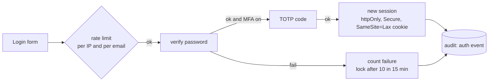

# Enterprise security plan

Status: DECIDED 2026-11-06. This page is the contract for auth and security work. It sits beside
`docs/saas-mvp.md` (tenancy) and `docs/threat-model.md` (threats). Wave 6 builds tier 1. Tiers 2 and 3
are the roadmap, written down now so nothing we ship today blocks them later.

## Where we are today

| Area | Today | Gap |
|---|---|---|
| Passwords | PBKDF2-SHA256 with salt, constant-time check, a decoy hash for unknown emails | No breached-password check, no lockout |
| Sessions | Random token, only its SHA-256 is stored, idle expiry, one session per user | Token sits in `localStorage` (`iw.session`), no rotation on privilege change, no "sign out everywhere" |
| Roles | owner, admin, member, viewer per org, checked on every route, default deny | No service accounts, no scoped API tokens |
| Isolation | Every route walked by a cross-tenant test, 404 not 403 | Proven on sqlite and Postgres, not yet on the deployed stack |
| Audit | Hash-chained audit log per workspace | Auth events (login, failed login, invite, role change) are not in it |
| Secrets | BYO LLM key stored per org | Encrypted with the app key only, no per-org key |

## Tier 1: ships before launch (wave 6, ticket S1)

1. **Cookie sessions.** The session moves from `localStorage` to an `httpOnly`, `Secure`, `SameSite=Lax`
   cookie scoped to the base path. A CSRF token is required on every unsafe method. Bearer tokens remain only
   for API clients.
2. **Rotation.** A new session id on login, org switch, role change and MFA enrolment. Sign out everywhere.
   An absolute lifetime (12 hours) on top of the idle expiry.
3. **Brute force.** Rate limits per IP and per email. A soft lock after 10 failures in 15 minutes, with the
   same answer whether or not the email exists.
4. **Password policy.** At least 12 characters, checked against an offline top-100k breached list that ships
   in the wheel. No composition rules.
5. **MFA.** TOTP enrolment with recovery codes. An org owner can require MFA for the whole org.
6. **Email flows.** Verify email, reset password and invite links: single use, 30 minutes, only the hash is
   stored. They are sent through an outbox. Locally the outbox writes to a file; hosted it uses a provider set by env.
7. **Service accounts.** Org-scoped API tokens with scopes (`read`, `ask`, `run`, `act:request`). They are
   shown once and stored as a hash. They can never approve anything.
8. **Auth audit.** Login, failure, lock, MFA change, invite, role change, token create and revoke all go into
   an org-level hash chain that admins can see and export.
9. **Headers.** HSTS, a CSP with no inline script, `X-Content-Type-Options`, `Referrer-Policy`,
   `Permissions-Policy`, and frame-ancestors none. CORS is closed by default.
10. **Signup mode.** `IRONWRIGHT_SIGNUP=open|invite|closed`. Production starts on `invite`, with a seeded
    demo org.

## Tier 2: enterprise plan (next, after launch)

| Capability | Shape |
|---|---|
| SSO | OIDC first (Okta, Entra ID, Google), then SAML 2.0. Per-org IdP config, domain verification, just-in-time membership, an SSO-only switch |
| SCIM 2.0 | Users and groups pushed from the IdP. Groups map to roles |
| Encryption at rest | Envelope encryption. One data key per org, wrapped by a KMS master key. Uploads, workspace files, snapshots on R2 and BYO keys are encrypted with the org key |
| BYOK | An org brings its own KMS key (AWS KMS, Azure Key Vault, GCP KMS). Revoking it makes the org's data unreadable to us |
| Field-level protection | PII columns found by the profiler are tagged. Masking policies per role are enforced in the ontology `masked()` path, which already exists |
| Network | IP allowlist per org, private connectivity to source systems later |
| Retention and deletion | Per-org retention for uploads, traces and audit exports. A full org delete runs as a job that crypto-shreds the org key |
| SIEM export | Auth and action audit chains are streamed to the customer's SIEM (webhook, S3, Splunk HEC) |

## Tier 3: compliance

| Framework | What it means for us |
|---|---|
| SOC 2 Type II | Controls mapped to code and CI evidence: access reviews, change management (the merge ladder), backups, incident runbooks, vendor list |
| GDPR / CCPA | DSAR export and erasure per data subject across uploads and silver, purpose tags on marts, EU data residency (R2 jurisdiction + an EU Postgres) |
| HIPAA | BAA-ready posture: PHI tagging, access logging on every PHI read, minimum-necessary masking, no PHI to an LLM unless the org's own key and region are used |
| Financial (SOX, GLBA) | Segregation of duties is already in the product (the requester never approves). Add evidence packs per quarter |
| EU AI Act | Agent decisions are traceable to evidence ids, a human approves every promotion, model and prompt versions sit in the trace |

## Rules that do not change

Default deny. An agent principal never comes from a request and can never approve. Tenant bytes never leave
their org's prefix. Every new security control comes with a test that fails without it.
