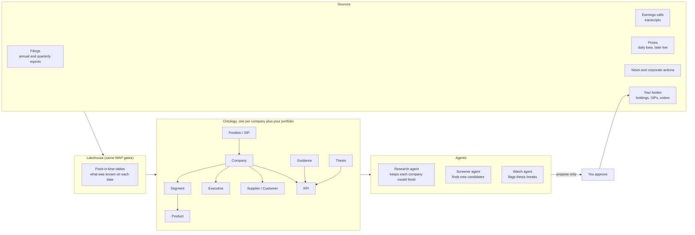
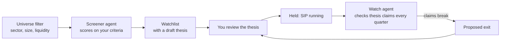

# Investing pack: Ironwright for a stock portfolio (design, ideation phase)

Can the same engine that models a retailer model a public company you invest in? Yes. A pack is
data, not engine code, so "a company I invest in" is just another business with its own objects,
links, problems and actions. The difference is where the data comes from (filings, prices, news)
and how careful the agent has to be (real money).

This is a design note, not financial advice. Nothing here should place real orders without a person
approving them.

## The shape of it

## Objects and links

| Object | What it holds | Comes from |
|---|---|---|
| Company | identity across ticker, ISIN, CIK and name; sector; subsidiaries | exchange and regulator filings |
| Segment, Product | how the company actually makes money, with revenue share over time | annual reports |
| Executive, Board member | tenure, ownership, past companies | filings, proxy statements |
| Supplier, Customer, Competitor | who the company depends on and competes with | filings, risk factors |
| KPI | revenue, margins, cash flow, debt, plus industry KPIs (same-store sales, NIM, ARPU) | XBRL facts, reports |
| Guidance | what management said they would do, and when | earnings calls |
| Risk factor | what management says could go wrong | filings |
| Thesis | why you own it, written as testable claims tied to KPIs | you |
| Signal | a measured change that supports or breaks a thesis claim | computed |
| Position, SIP | what you hold, monthly amount, cost basis | your broker |

"Operating style" becomes measurable instead of a vibe:

- **Capital allocation:** buybacks, dividends, capex and acquisitions as a share of cash flow, by year.
- **Say versus do:** every guidance statement reconciled against the KPI that later arrived. This is the same reconciliation engine Ironwright uses for legacy reports, with "known differences" for one-offs.
- **Concentration:** revenue share of the top segment, top customer, top supplier.
- **Management skin in the game:** insider ownership and changes over time.

## The rule that matters most: point in time

Every table is keyed by the date the information became public, and every agent reads "as of" a
date. This is the same as-of join the retail pack uses for planograms. Without it, a backtest
quietly uses information from the future and looks far better than reality.

## Actions and policy

| Action | Who | Policy |
|---|---|---|
| `refresh_company_model` | research agent | allowed |
| `flag_thesis_break` | watch agent | allowed, notifies you |
| `add_to_watchlist` | screener agent | allowed, max 5 per week |
| `propose_sip_change` | agents | needs your approval; change within plus or minus 25% |
| `propose_swap` (exit one, add one) | agents | needs your approval, with the thesis diff attached |
| `place_order` | agents | forbidden. Only you, through your broker |

Every proposal carries its evidence ids (which filing, which call, which price window), the same way
the AML agent cites alerts.

## Rotation: finding new, flushing old

## Evals before any real money

- **Extraction:** KPIs pulled from filings match the official numbers (precision, recall, per field).
- **Identity:** the same company across tickers, ISINs and subsidiaries resolves to one object.
- **No lookahead:** a test that fails if any agent read touches data published after its as-of date.
- **Backtest honesty:** decisions scored against what happened next, with costs and taxes, over several market regimes.
- **Groundedness:** every claim in a thesis or proposal cites a source document.

## Phases

1. **Historical only.** Backfill 5 to 10 years of filings and daily prices for your 10 to 15 SIP companies. Build the models and backtest the watch agent. No live data.
2. **Live data, paper trading.** Daily refresh, proposals go to a paper account. Measure for a few months.
3. **Live, with approvals.** Proposals come to you; you place orders yourself or approve each one.
4. **Narrow automation.** Only SIP amount changes inside tight limits, and only if phase 3 earned it.

## Rules and limits to respect

- **India:** SEBI's retail algo framework means automated orders through broker APIs go through the broker's registered algo setup. The full framework applies to all brokers from April 1, 2026. Check your broker's current terms before automating anything.
- **United States:** many brokers offer an API with a paper-trading mode. Start there.
- **Data licensing:** filings are public, but live price feeds and news usually have usage terms. Read them before storing or redistributing.
- **What the ontology cannot do:** it organizes what is knowable. It does not predict prices. Its job is to make your decisions faster, consistent and explainable, and to tell you when your own thesis stops being true.
