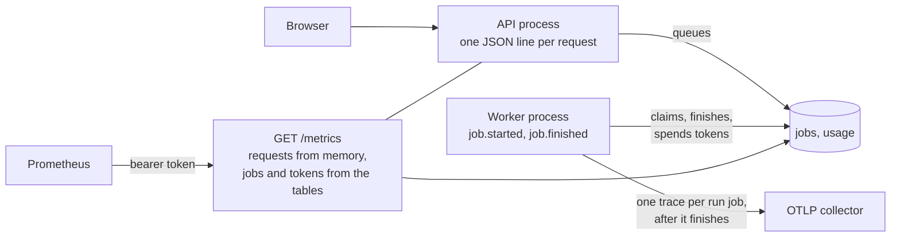

# Running the hosted stack: what to watch and how to debug it

This page is for whoever is on call for a hosted Ironwright. You do not need a shell for any of it.
I built three signals: logs, metrics and traces. None of them hold tenant data.



## What never leaves

| Signal | What it has | What it never has |
|---|---|---|
| Logs | ids, route template, status, durations, exception type, file and line | bodies, keys, tokens, raw paths, query strings, exception messages |
| Metrics | counts, seconds, org ids, route templates, job kinds | org names, workspace names, emails |
| Traces | our span names, counts, exception type, org id | table and rule names, check conditions, exception messages |

The full error text stays in two places inside the org's own prefix and the jobs table: the job's
`error` and its log. The tenant reads those. I do not copy them anywhere else, because a parser
message can quote a cell.

## Logs

Every process writes JSON lines to stdout, so whatever ships your container logs can ship these.
Stage progress from a run also prints to the worker's stdout as plain text. Filter on lines that
parse as JSON.

| `event` | Written by | Fields |
|---|---|---|
| `request` | API | `request_id`, `org_id`, `user_id`, `method`, `route`, `status`, `duration_ms` |
| `request.crashed` | API | `request_id`, `org_id`, `user_id`, `route`, `error_type`, `stack` |
| `job.started` | worker | `job_id`, `org_id`, `user_id`, `workspace`, `kind` |
| `job.finished` | worker | the same, plus `state`, `error_type`, `owned`, `duration_ms` |
| `job.requeued` | worker | `job_id`. A worker died and this job went back on the queue |
| `worker.loop_failed`, `worker.heartbeat_failed` | worker | `error_type`, `stack` |
| `trace.export_failed` | worker | `job_id`, `org_id`, `error_type` |
| `metrics.database_failed` | API | `error_type` |

Every response carries `X-Request-ID`, which I generate. A client's own value is ignored. When a
user reports a bad request, ask for that header and search for it. A 500 shows the same id in its body.

`/healthz`, `/readyz` and successful scrapes write no lines. A refused scrape does.

`owned: false` on `job.finished` means this worker lost the job to a requeue, so its result was thrown away.

## Metrics

Set `IRONWRIGHT_METRICS_TOKEN`, then scrape with `Authorization: Bearer <token>`. Unset means nobody
gets in. A tenant owner's session is refused too, and so is a dev-open server.

```yaml
scrape_configs:
  - job_name: ironwright
    metrics_path: /metrics
    authorization: {credentials_file: /etc/prometheus/ironwright-token}
    static_configs: [{targets: ["api:8000"]}]
```

| Series | Type | Read from |
|---|---|---|
| `ironwright_requests_total{route,status}` | counter | this API process |
| `ironwright_request_seconds_total{route}` | counter | this API process |
| `ironwright_quota_refusals_total{org_id,route}` | counter | this API process. The sign-in limit does not count here |
| `ironwright_jobs{kind,state}` | gauge | `jobs` table |
| `ironwright_job_duration_seconds_count`, `_sum{kind,state}` | summary | `jobs` table, from claim to finish |
| `ironwright_queue_depth` | gauge | `jobs` table |
| `ironwright_queue_oldest_age_seconds` | gauge | `jobs` table |
| `ironwright_llm_tokens_total{org_id,source}` | counter | `usage` table. `source` is `platform` or `byo` |
| `ironwright_metrics_database_up` | gauge | 1 if this scrape could read the database |

Three things to know when you read these:

- The worker is another process, so everything it moves comes from the shared tables. Those numbers
  survive restarts and do not depend on which API you scrape.
- Request counters live in the API's memory. With more than one API, scrape each one and sum them.
- `ironwright_llm_tokens_total` counts what orgs spend through the metered model. The demo packs and
  the dev org without a key of its own are not metered, so a platform bill can read higher than this.

`ironwright_jobs{state="failed"}` only grows unless rows are removed, so `increase()` on it works
as a failure count even though it is a gauge. A reaper-failed job is in this count with no
`job.finished` line, because the worker that held it is dead.

## What to alert on

These thresholds are my starting points. I have not tuned them against real traffic, so move them
once you have a few weeks of your own numbers.

| Watch | Page when | First thing to check |
|---|---|---|
| `ironwright_metrics_database_up` | 0 for 2 minutes | Postgres, then `/readyz` |
| 5xx rate: `rate(ironwright_requests_total{status=~"5.."}[5m])` over all requests | above 2% for 10 minutes | `request.crashed` lines, group by `route` and `error_type` |
| `ironwright_queue_oldest_age_seconds` | above 300 for 10 minutes | is the worker up, then one org's job holding the per-org slot |
| `ironwright_queue_depth` | above 50 for 15 minutes | `IRONWRIGHT_WORKERS` against what is queued |
| `increase(ironwright_jobs{state="failed"}[1h])` | above 5, or over 25% of finished runs | `job.finished` lines, group by `error_type` |
| `job.requeued` lines | more than 3 in 1 hour | worker memory and restarts |
| `increase(ironwright_llm_tokens_total{source="platform"}[1d])` | one org above 80% of its plan | whether that org should move plans or add its own key |
| `increase(ironwright_quota_refusals_total[1h])` | above 20 for one org | not an outage, but that team is stuck. Tell them |
| `trace.export_failed` lines | any for 30 minutes | the collector. Jobs are not affected |

## Traces

Set `OTEL_EXPORTER_OTLP_ENDPOINT` on the worker to a collector's base URL. Empty means no export.
For the bundled one:

```bash
OTEL_EXPORTER_OTLP_ENDPOINT=http://otel-collector:4318 \
  docker compose -f deploy/compose.yaml --profile otel up --build
```

That collector prints what it receives. Point its exporter at your backend to keep traces. Any
authentication to the backend belongs in the collector, because the worker sends no headers.

Each `run` job is one trace, and **the trace id is the job id**. A `job.run` root span holds a span for
each stage. On a demo pack they are named `stage.<name>`. On a tenant workspace they are the pipeline's
own: `migrate`, `reconcile`, `ontology.build`. A failed span has error status and the exception type.

Agent decisions on a demo pack stay as their own traces, because the showcase and the console read
them one by one. They are on disk and are not part of this export. `POST /workspaces/{name}/otel/export`
still sends those, whole and unscrubbed, to the endpoint the caller names. Do not point it at a shared
collector for a tenant workspace.

A worker that dies mid run exports nothing. Its job gets `job.requeued`, and the next attempt adds to
the same trace id. Only `run` jobs export.

## Debugging a failed job

1. Start from the job id, or find it: `event = job.finished AND state = failed AND org_id = <org>`.
2. Read `error_type` and `kind`. A `kind` of `run` with `ValueError` is usually the tenant's data or
   mapping. `OperationalError` or `OSError` is usually ours.
3. Open the trace with the job id as the trace id. The first span with error status is the stage that
   failed. Its sibling counts (`rows`, `checks`, `failed`) tell you how far it got.
4. Check whether others are failing the same way: group `job.finished` by `error_type` over the last
   hour. One org means their data. Many orgs means the stack, so check `/readyz` and
   `ironwright_metrics_database_up`.
5. Need the message? It is the tenant's data, so ask the tenant. An org member sees it in the console,
   or at `GET /jobs/{id}` (the `error` field) and `GET /jobs/{id}/log`. Those routes are scoped to the
   org. An operator's token does not open them, and that is on purpose.
6. If the job is stuck `running`, look for `job.requeued`. A job with no heartbeat for
   `IRONWRIGHT_JOB_HEARTBEAT_TIMEOUT` seconds goes back on the queue, up to 3 attempts, then fails.

## Debugging a failed request

Search for the `X-Request-ID`. A `request` line gives the status and the route. A `request.crashed`
line with the same id gives the type and the file and line. A 429 on a route other than sign-in is a
plan limit: see `ironwright_quota_refusals_total`. A 429 on `/auth/*` is the sign-in limit.
