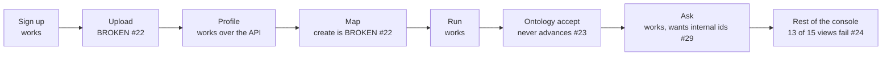

# Product review, November 2026

I used Ironwright as a new customer would, from a fresh checkout of main at `bf5ca2b`. This page says what I found.

## Launch readiness: not ready

The engine and the walls around it are good. The console is not connected to them. On a real server, a new customer cannot get past step 2 of the wizard, and no customer's first upload reaches an answer through the UI. Every test stayed green because the wizard's browser test replaces the routes it needs with stand-ins.

Launch once #22 and #23 are fixed and the wizard test runs on the real app. #24 should follow right after, because without it a customer cannot see their own tables.

| What I tested | Result |
|---|---|
| API journey to a grounded answer, on Postgres | holds: `JOURNEY complete` |
| Wizard in a browser, no shim | **broken at step 2** |
| Console views on your own workspace | **13 of 15 show an error** |
| Org B reaching org A | **held: no leak** in 150 swept requests and about 20 hand made attacks |
| Viewer | holds on writes, cannot Ask |
| Quotas, all 6 | hold, each at its exact number |
| BYO key | holds: used, never shown |
| Refresh logic | holds over the API, no console path |
| Delete | holds: nothing left but the promised audit line |
| Export | runs, and holds no rows for a wizard workspace |
| Logs and metrics | hold: no canary in any log |

## How I tested, and what I could not

| Ticket step | What I ran | Limit |
|---|---|---|
| 1 Compose | **Not run locally.** The Docker daemon on this laptop did not answer even a raw `_ping` for the whole session, and I did not restart it because other sessions share it | CI's `hosted-smoke` and `e2e` jobs boot compose and were green on `bf5ca2b`. Neither loads the console. Running the walk on compose is still open |
| 1 Instead of compose | The same processes natively: Postgres 16 in a private cluster, `serve-platform`, `ironwright worker`, a real S3 lake path | The S3 store was moto's server, not Versity |
| 1 Local path | `serve-platform` on SQLite and local paths, `make demo-check` | |
| 2 Browser | Headed Chromium through Playwright | See the shim below |
| 5 BYO key and tokens | Real server code, with provider hostnames sent to a local stub | No real provider was called |

**The shim.** The wizard cannot pass step 2 (F-01), so to review the screens behind it I put a small `fetch` adapter in the page. It only translates the wizard's calls to the routes that exist, and it answers the ontology read from F-02. Screenshots `03-*`, `04-*` and `06-*` were taken through it. `02-*`, `05-*`, `07-*` to `13-*` had no shim. The shim is not in this PR.

Canaries I planted and searched for: cell values, passwords, the BYO key, the platform key, the metrics token and the object store secret.

## Findings

Fixed means fixed in this PR with a test. A number means a GitHub issue labeled `review-2026-11`.

| ID | Sev | Area | What happened | Expected | Repro | Evidence | Status |
|---|---|---|---|---|---|---|---|
| F-01 | P0 | Wizard | Upload lands, then `no such resource`. The wizard's real calls answer 404, 405 and 422. `_install_gaps` in the test hides all of it | Upload moves on to Profile | Sign up, upload anything | `02-F01-upload-dead-end.png`, `02-F01-after-reload.png` | #22. The profile call is known: F1 |
| F-02 | P0 | Wizard | After accept the job says succeeded and the wizard never reaches Ask, because `GET .../ontology` 404s for a tenant | Lands on Ask | Accept any ontology | `03-ontology-proposal.png` | #23 |
| F-03 | P1 | Console | 13 of 15 views show `no workspace named acme-sales` beside the selector naming it | Views work, or are hidden | Open any view on your workspace | `05-view-Data_explorer.png`, `05-view-Audit.png` | #24 |
| F-04 | P1 | Data | The trailer becomes an object: a `PoliciesFixed` titled `END OF`. CSV silver has 10 rows from 9 records. `0 flagged` | Trailer is skipped and counted | Upload a file with a trailer | `06-map.png`, `06-ontology.png` | #25 |
| F-05 | P1 | Data | One duplicate row means the main table gets no object, and the fix offered needs SQL the wizard cannot take | A way forward in Map | Upload a CSV with one repeated id | `06-ontology.png` | #26 |
| F-06 | P1 | Refresh | No console path to refresh a file or add a second dataset | Upload a new version in the UI | Finish the wizard, look for it | `05-view-Sources.png` | #27 |
| F-07 | P1 | Export | A wizard workspace exports 2,460 bytes and 0 rows. Delete is thorough, so export then delete loses the work | Silver tables in the zip | Export after the wizard | `11-your-data.png` | #28 |
| F-08 | P1 | Ask | `show me customer 1001` is refused. Only made up ids like `CUS-37558743` resolve. Answers show `_id`, `_title`, `00:00:00` | The file's own ids work | Ask with an id from your file | `04-ask-free-0.png`, `04-ask-1-example.png` | #29 |
| F-09 | P1 | Demo | A tenant gets 403 on Ask on a demo pack, and Run is offered on a read only pack | Ask works on demos | Explore a demo, Ask | `13-demo-ask-as-tenant.png`, `09-Quillback-run-attempt.png` | #30 |
| F-10 | P2 | Roles | A viewer cannot Ask, and can read the ask log. 13 other writes correctly refused | Ask counts as reading, or the screen says why | Ask as a viewer | `07-viewer-settings.png` | #31 |
| F-11 | P2 | Security | The signup decoy hides nothing: `GET /auth/me` with its token is 401, and 200 for a real signup. No access gained, I checked both passwords | The docstring's claim holds | Sign up twice, call `/auth/me` | none, API | #32 |
| F-12 | P2 | Profile, Map | Mixed dates read as `fit no narrower type`. Map has no decimal. Fixed width merges an amount and a date with no way to split | Parse shares, a field editor | Upload my messy files | `06-profile.png`, `06-map.png` | #33 |
| F-13 | P2 | Operator | Every failed job logs `JobError`. Drift and a parser failure look the same, so the reason needs the database | A closed error code in the log | Run after a missing key column | `docs/operations.md`, worker log | #34 |
| F-14 | P2 | Gate | `make demo-check` fails every evening west of UTC. The script builds "tomorrow" in local time, and grants expire in UTC | Green at any hour | Run after 18:00 CST | `tests/test_review_2026_11.py` | Fixed |
| F-15 | P2 | Quotas | A refused PDF or empty file spends a daily upload | Only a stored upload counts | Upload a PDF, read usage | `tests/test_quotas.py` | Fixed |
| F-16 | P2 | Sign up | A returning customer who signs up lands back on the login form with no word why | The form says what to do | Sign up with an existing email | `10-returning-user-signup.png` | Fixed. The check reads the decoy's dead session, the same signal as F-11. It reveals nothing the API did not, and #32 must change it |
| F-17 | P2 | Local path | `make console` prints `up to date` and builds nothing: a folder has the same name | It builds | `make console` on a fresh clone | `make -n console` | Known: F1 |
| F-18 | P2 | Local path | On a clone without a build, `/console/` and `/` are bare 404s. CLAUDE.md and a code comment say the build is committed. It is gitignored | `/` says how to get the console | `serve-platform` on a fresh clone | `tests/test_review_2026_11.py` | Fixed. The hint names `make console`, which builds once F1 lands |
| F-19 | P2 | Run report | `0 reconciliation rules ... cutover ready` over a file with a junk row | Say nothing was reconciled | Run any wizard workspace | `06-run.png` | Fixed |
| F-20 | P3 | Gate | `demo-check` checks four pack exports. There are five, and `insurance_policy` is not among them | All packs | Read the Makefile | `Makefile` | Fixed |
| F-21 | P3 | Copy | Workspaces says `The four demo companies` above five | No count to go stale | Open Workspaces | `05-console-home.png` | Fixed |
| F-22 | P3 | Console | The badge and principal id spill out of the sidebar over the page | Stay inside it | Open any workspace | `05-view-Data_explorer.png` | Fixed |
| F-23 | P3 | Copy | Storage reads as `1073741824`, on the Usage tab and in the refusal | `1.0 GB` | Open Usage | `08-owner-tab-usage.png` | Fixed |
| F-24 | P3 | Copy | Map tells a customer `Contract 3 cannot skip them yet` | Plain words | Upload a file with a trailer | `06-map.png` | Fixed |
| F-25 | P2 | Demo | `docs/DEMO-SCRIPT.md` no longer matches the product. Rewrites below | | Read it | below | Noted |
| F-26 | P3 | Quotas | A refused Ask question spends one of the 100 | Maybe only answers count | Ask nonsense, read usage | `07-viewer-settings.png`: 3 refusals among the 5 counted | Open: a product call |
| F-27 | P3 | Copy | `acting as user:<id>`, `evals green on this machine` on a hosted server, `New organization` for a tenant, a workspace card titled `Draft from customers, orders` instead of its name, Pipeline's `Nothing has run` after a run | Words for a hosted customer | Open the console | `05-console-home.png`, `05-view-Pipeline.png` | Open: same screens as #24 |
| F-28 | P3 | Security | The session token is in `localStorage`, so any XSS can read it | Consider an HttpOnly cookie | Read `api.js` | `console/src/api.js` | #37 |
| F-29 | P3 | Security | A tenant can read `duckdb_settings()` on a demo lake. No secret: `duckdb_secrets()`, `getenv` and the S3 setting are refused | Maybe refuse it | `POST .../lake/query` | none, API | Open |
| F-30 | P3 | Gate | The house rule says ruff clean. `ruff check .` finds 83 errors on main in files this PR does not touch, and CI does not run it | Clean, and a CI step to keep it so | `ruff check .` | `.github/workflows/ci.yml` | #36 |
| F-31 | P3 | Sign up | `Create the org` stays disabled with no reason until all three fields are filled. A short password is fine: it gets `a password needs at least 8 characters` | Say what is missing, or let it submit and say so | Open sign up | `01-signup-empty.png`, `01-signup-weak-pw-submitted.png` | Open: minor, and the empty fields are visible |
| F-32 | P2 | Console | The console's `index.html` is cached. Reported from the PMO's live walk. I did not reproduce it | A new build shows up on reload | See F1 | none from me | Known: F1 |

## Known, being fixed in F1

The PMO found these three in a live walk. They are being fixed on `saas/f1-journey-seams`, so this PR leaves them alone.

| Finding | What | In this review |
|---|---|---|
| F-01, in part | The wizard's profile step calls `POST /jobs` instead of `POST /uploads/{id}/profile` | I found it too. The rest of #22 is separate: `GET /uploads`, the `POST /workspaces` body, the job lookup and `_install_gaps`. I could not see F1's branch on the remote, so I do not know if it covers those |
| F-17 | `make console` is a no-op, because `.PHONY` does not list it, so local runs serve a stale console | I found it too. I had fixed it here and took the fix back out |
| F-32 | The console's `index.html` is cached | Theirs. I did not test it |

## What held

These matter as much as the gaps. I tried to break them and could not.

**Isolation.** The journey's sweep made 150 refused requests, all byte for byte the gate's 404. By hand, org B also tried: A's slug, upload, job and workspace names in URLs and bodies; encoded traversal in paths; traversal in a source ref; `X-Org` and `X-Principal` headers; A's export by job id; SQL file reads against A's paths. Nothing came back.

Two 200s need a word, since the ticket calls any 200 a P0. `GET /jobs?workspace=acme-sales` is 200 and empty, and reads the same as a name nobody has. Reads on demo packs are 200 by contract, and the audit rows there hold only the demo's own actors.

**Viewer.** 13 writes refused with a 403, including run, profile, accept, approve, act, cancel, invite, keys, export and delete.

**Quotas.** Each fired at its number with a clear sentence.

| Limit | Refused at | `Retry-After` |
|---|---|---|
| Uploads | 21st | yes |
| Runs | 21st | yes |
| Ask | 101st | yes |
| Members | 6th seat, counting open invites | no |
| Model tokens | first question after passing 50,000 | yes, and it offers your own key |
| Storage | the 11th 99 MB file, at 990 MB | no |

**BYO key.** The stub received the org's key and never the platform's. The API shows provider and last 4 only. Tokens landed on the BYO counter. A bad key's refusal does not repeat it, and the key is not in Postgres, the logs or the audit rows in plain text.

**Refresh.** An added column is info and runs. A missing key column blocks with `The key column claim_id is gone`, and Ask keeps serving the last good data.

**Delete.** It wants the slug typed. In 1.2 seconds: 74 S3 objects to 0, the org's folder gone, no canary anywhere under the data root, 17 Postgres rows to 2. Those 2 are the audit line the screen promises, holding ids and a hash. The session dies and the login fails.

**Logs and metrics.** Across the whole session, no cell value, password, key or token in the API or worker logs. `/metrics` refuses no token and refuses a tenant owner. It held no deleted org id.

**Speed.** Nothing was slow on these small files.

| Step | Time |
|---|---|
| Profile | 0.6 s |
| Create workspace | 0.3 s |
| Run | 2.1 s |
| Propose ontology | 1.3 s |
| Ask | 37 ms |
| Delete | 1.2 s |

## The demo story

The insurance packs hold. Granite Mutual and Quillback Casualty both opened every console view with no failed request, and every pack passes every eval layer. Reading them works for a tenant. Doing things does not (F-09).

The 1:41 script is written for one person on a laptop with a dev-open console. It does not mention a tenant anywhere, and that is now the headline. It should say:

| Beat | It says | It should say |
|---|---|---|
| 0:00 | Four fictional companies | Five, or say "these companies" and stop counting. Quillback is missing from README and the script |
| 1:30 | Four workspaces, Ask answers | Say this runs dev-open with `IRONWRIGHT_DEV_OPEN=1`. A signed up tenant gets a 403 on Ask here until #30 |
| 1:40 | Invite only sign-in, seeded by `auth-set` | Anyone can sign up and gets an org. Show the sign-up, then org B getting a 404 on org A's job id |
| 1:41c | Profiler and hosted auth stay PLANNED | Both shipped. Delete the sentence |
| 1:41d | Both servers bind 127.0.0.1 | Local still does. The hosted stack binds inside the container and publishes on loopback |
| 2:10 | 157 tests | Stop quoting a count, it was already wrong |
| New | | The beat that now sells it: your files, the wizard, a grounded answer, a second org that cannot see it, delete with nothing left. Do not demo the wizard until #22 and #23 are fixed |

## Top 5 next steps

1. Fix #22 and #23, and delete `_install_gaps` in the same PR, so the browser test runs on the real app. This is the launch blocker, and the test change is the part that stops it coming back.
2. Add a console step to the `e2e` CI job. It walks the API today, and that is how this got to main.
3. Fix #24, so a customer can see their own tables, audit and policies.
4. Fix the data seams that make a real export look broken: #25 trailers, #26 duplicates, #29 the customer's own ids.
5. Fix #27 and #28 together: refresh in the UI, and an export that holds the data. A team cannot run on this for a month without both.

## Contract asks

- Contract 3: add `layout.skip_footer`. The profiler already finds it, and Map already explains its absence (#25).
- Contract 5: add `GET /uploads`, and say so. The wizard depends on it and the page does not list it (#22).

## Cross-ticket asks

None. Each fix here is local. I left the wizard and the tenant routes alone, because they are the P0 and P1 issues above.
