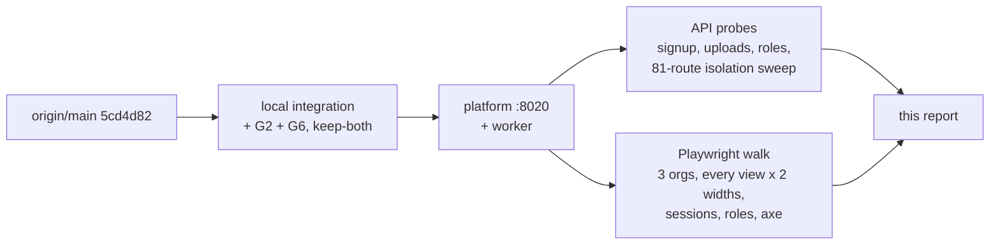

# Production QA, November 2026 (Q1)

I ran the stack that is about to ship as a strict buyer's QA lead would, on 2026-11-06 and 07. This page lists what broke, what held, and whether I would launch.

## What I tested

The ticket said to merge `saas/g2-tenant-views` and `saas/g6-tenant-actions` onto main. Neither merges cleanly onto `origin/main` at `5cd4d82`, because both were cut before #43 (G3) landed. Main plus G2 alone conflicts too, so the ticket's fallback did not apply. I resolved the textual conflicts keep-both, in a local branch I never pushed:

| Step | What | Result |
|---|---|---|
| 1 | `origin/main` `5cd4d82` + G2 `a7c8691`, conflicts in `ci.yml`, `BIEmbed.jsx`, `build-log.md`, `platform_api.py` (ask log routes kept main's per-org log) | merged |
| 2 | + G6 `2afa101`, conflicts in `platform_api.py` (imports, `WRITE_ROLES`, governed routes take G6's `_serving_pack`), `build-log.md` | merged, **but 500s** (QA-01) |
| 3 | Two local fixes so I could keep testing: restore `workspaces_tenant as wt`, and point main's three `_ask_pack` calls at G2's `workspace_pack` | `pytest -q`: **2253 passed, 1 failed** (QA-02), 610 skipped |

The second fix in step 3 was my own merge mistake, so it is not a finding. Everything below ran on that integration unless a row says main.

- **Stack.** `ironwright platform --port 8020` and `ironwright worker`, SQLite, local disk, `IRONWRIGHT_DATA` in a scratch dir, `IRONWRIGHT_DEV_OPEN` unset. Console built with `npm run build` from the integration. To prove QA-03 is on main and not only on the integration, I ran pure main once on a spare port.
- **Browser.** Headless Chromium through Playwright, at 1440x900 and 390x844, with axe-core 4.10.2 on every desktop view.
- **Walk.** `tests/qa/test_production_walk.py` is in this PR. It skips in plain `pytest -q`, and its docstring says how to re-run it. Its raw log is `docs/review/qa-2026-11/walk.json`. That log also names shots I pruned from the PR, which were views with no finding.
- **Not covered.** Compose, Postgres, the S3 lake and the Cloudflare route. Item 9 keyboard covered the sign-up door only, not every wizard step. The click-everything pass skips buttons that delete, deny, approve, export or sign out, and it misses buttons that re-render while it walks.

## Findings

Severity: P0 blocks launch, P1 must fix before launch, P2 polish, P3 nice. Each P0 and P1 has its own issue, labeled `qa` (#51 to #56). P2 and P3 are one checklist, #57. Shots live under `docs/review/qa-2026-11/shots/`. "API" means the evidence is the request itself, written in the steps.

| ID | Sev | Area | Steps to reproduce | Expected | Actual | Shot | Owner |
|---|---|---|---|---|---|---|---|
| QA-01 #51 | P0 | Governed actions on a tenant workspace (integration) | Merge G2 and G6 onto main keep-both. Sign up, finish the wizard, then `GET /workspaces/<ws>/objects/<Type>` | 200 | 500 `internal error` with a request id. Server log: `NameError: wt` in `_serving_pack`. G2 moved `workspaces_tenant as wt` out of `platform_api.py`, and G6's new resolver still calls `wt.`. Objects, audit, approvals, decide, act and ontology all 500 on every tenant workspace. The journey's `govern_action` step goes red. `ruff --select F821` catches it | API, `walk.json` none | api |
| QA-02 #52 | P1 | Approvals on a tenant workspace (integration) | Same merge. A member asks for an accepted action, then the owner opens the workspace | An Approvals view to decide it | The rail hides Approvals: G2 added `TENANT_HIDDEN = {agents, training, approvals}` and G6 needs the view. A member's request can never be approved in the UI. `tests/test_console_actions.py` fails on the integration and passes on G6 alone | `v-qa-desk-Pipeline.png` (rail note) | console |
| QA-03 #53 | P1 | Reads under concurrency (**on main**) | Any workspace, 12 parallel `GET`s over `ontology`, `approvals`, `audit`, `training/labels` | 200 for all | Main: 2 of 24 answer 500. Integration: 13 of 24 on a demo pack, 10 of 24 on a tenant workspace. `TransactionException` in `OntologyStore.__init__`, which runs `create or replace macro` (a write) on every read. The walk hit it by just opening Approvals on Harborview Bank. Demo packs are shared by every org, so normal traffic will hit it | `v-banking_aml-desk-Approvals.png` | api |
| QA-04 #54 | P1 | Sign-in rate limit behind a proxy | Read `api.py` `LoginLimit` and `hosted.serve`. Locally: 7 wrong logins for one account, then a correct login for any other account from the same address | One person's typos lock only that person, or that client | The bucket is `(path, socket address)`, and both servers run with `proxy_headers=False`. Behind Cloudflare, Railway or any load balancer, every customer has the proxy's address, so 10 attempts a minute is the budget for all customers together. One script locks everyone out of sign-in, sign-up and invites. Locally I saw 429 for a different account after the shared budget ran out | API | auth, deploy |
| QA-05 #55 | P1 | Password rules | Sign up with a password of 8 spaces, or `password` | Refused, with a rule the field states | Both create an org and a session. The only rule is `len >= 8`. The field has no `minlength` and states no rule | `s-spaces-password.png` | auth |
| QA-06 #56 | P1 | Back, forward, deep links | Open a workspace, click Ask, then Audit, then press Back | Back goes to Ask. A link can open a view | The URL stays `/console/` on every view. Back leaves the app to the previous site (`about:blank` in the walk). `/console/#ask` in a new tab opens Workspaces. Reload does keep the view, through `iw.last` | `n-back-from-audit.png`, `n-deep-link.png` | console |
| QA-07 | P2 | Two devices | Sign in on a laptop, then sign in as the same person on a phone, then use the laptop | Both sessions live, or the first one is told why it ended | `_open_session` deletes every other session of that user. The laptop's next call is 401 and it drops to the door with no word why. Two tabs share one session, so they are fine | API (`/auth/me` 401 for the first token) | auth |
| QA-08 | P2 | Sign out in one tab | Open two tabs, sign out in one, click Audit in the other | The other tab goes to the door | It keeps the signed-out user's email, principal id and workspace list on screen. Its next call shows `no session` in a red box and stays put: `req()` only reloads on a 401 when it sent a token | `s-second-tab-after-signout.png` | console |
| QA-09 | P2 | Viewer screens | Invite a viewer, accept, open Pipeline and Boards | Writes the server refuses are hidden or disabled, with the reason | Run the pipeline and Create with starter tiles are live buttons. The server refuses with a clear 403, so nothing breaks, but the screen offers what the role cannot do. Sources hides its writes correctly | `r-viewer-Pipeline.png`, `r-viewer-Boards.png` | console |
| QA-10 | P2 | Create from upload over the API | Upload `tests/fixtures/ingest/messy/claims_export.csv`, profile, then `POST /workspaces {from_upload, spec, slug}` with only the proposal's `workspace` (no `records`, no `silver`). Run, propose, accept | Same result as the wizard: the trailer skipped and nulls cleaned | A `ClaimsExport` titled `*** END OF EXTRACT - 8 RECORDS ***`, and objects holding `NULL`, `N/A`, `0000-00-00` and two date formats as text. The wizard path is clean, because it sends `records` and `silver`. The API defaults both to off, so it ignores the profiler's own proposal | API | api, ingest |
| QA-11 | P2 | Header-only CSV | Upload `id,name,amount\n` | "This file has a header and no rows" | Accepted and profiled as `field_1`, `field_2`, `field_3`, with the header as a data row. `_is_header` needs rows to compare against | `u-header-only-csv.png` | ingest |
| QA-12 | P2 | Unicode headers | Upload a CSV with header `Ünït Prïce €` | `unit_price` | `n_t_pr_ce`, shown in Ask as `N t pr ce`. `snake()` drops every non-ASCII letter instead of folding it (NFKD) first | `j-nasty-06-ask.png` | ingest |
| QA-13 | P2 | Malformed request bodies | `POST /auth/signup {}`, or a body that is not JSON | A sentence | Raw FastAPI JSON: `[{"type":"missing","loc":["body","email"],...}]`. `api.js` would show it with `JSON.stringify`. The console's own forms do not send these, so only an API caller sees it | API | api |
| QA-14 | P2 | Data explorer row counts | Finish the wizard on `ingest/join`, run the pipeline a few more times, open Data explorer | `customers · 6 rows`, as the view it opens says | The count grows by 6 every run: `24 rows` after four runs (shot), `30` after five on another org. The list counts the all-runs table and labels it with the latest-run name. `select count(*) from bronze_customers` is 6 | `v-qa-desk-Data_explorer.png` | console, api |
| QA-15 | P2 | Phone width | Open any view at 390x844 | The view, with the rail tucked away | The full rail (about 20 links) stacks above the view, so every tap changes content below the fold. No horizontal scroll, which is good | `p-phone-ask.png`, `v-qa-phone-Ask.png` | console |
| QA-16 | P2 | Accessibility | axe-core on every desktop view | No critical violations | `select-name`, critical: the sidebar's workspace select has a `div`, not a label (76 view loads). `label`, critical: the Principals input. `aria-required-children`, critical: the Platform map SVG. `scrollable-region-focusable`: Training. No contrast violations. Keyboard on the door: every stop has a visible focus ring | `v-qa-desk-Principals.png`, `v-retail-desk-Platform.png` | console |
| QA-17 | P2 | Speed on the fixtures | Wizard on `ingest/join` and on `tenant_ws` | Each step under 2s | Accept to Ask 2.9s (join), run 2.3s (tenant_ws). Every other step is under 2s, and every view opens in under 2s. My own 50k-row and 30 MB files took 2.5s to profile, 2.3s to run and 5.4s accept to Ask, and all reached a cited answer | `walk.json` | ontology, jobs |
| QA-18 | P3 | Copy | `grep -c $'\u2014' console/dist/assets/*.js` (U+2014, the em dash) | 0 | 1: the empty time cell in Pipeline. API messages have none | none | console |
| QA-19 | P3 | Copy | Open any page | Plain words for a customer | The sidebar shows `acting as user:<32 hex>`. Badges say `evals green on this machine` on a hosted product | `v-retail-desk-Platform.png` | console |
| QA-20 | P3 | Platform map | Open Platform at 1440 | Four lanes fit | The SEMANTIC lane is cut off at the panel edge | `v-retail-desk-Platform.png` | console |
| QA-21 | P3 | Consistency | Wrong password at the door, then any refusal | One voice | Server messages start lowercase (`that email and password do not match`) and the page copy is sentence case. `sign out` in the sidebar and `Sign out` in the wizard. The error box is wider than the card above it | `s-wrong-password.png`, `r-viewer-after-join.png` | console, api |
| QA-22 | P3 | Copy | 11 sign-ups in a minute from one address | Words that fit | A sign-up is refused with `too many sign-in attempts` | API | auth |
| QA-23 | P3 | Headers | `curl -I /console/` | HSTS and a permissions policy on the hosted app | CSP, `nosniff` and `no-referrer` are set. No `strict-transport-security`, no `permissions-policy`. Cloudflare can add HSTS at the edge, so this may be a deploy line rather than code | API | deploy |
| QA-24 | P3 | Names | Upload `50k-unicode.csv` | A type name a person would choose, or an easy rename | `C50kUnicode`, asked as `c50k unicode` | `j-nasty-05-ontology.png` | ontology |
| QA-25 | P3 | Dates | Open Pipeline, then an object | One date format | Pipeline says `11/6/2026, 7:28:29 PM` (browser locale). Objects store `2024-02-03 00:00:00` for a date column | `r-viewer-Pipeline.png` | console, ontology |

Already filed and still true, so not refiled: #31 a viewer cannot Ask (`r-viewer-after-join.png`), #32 the sign-up decoy, #37 the session token in localStorage, #36 ruff is not in CI (`ruff check .` has 90 lines on main).

## What held

| Area | Result |
|---|---|
| Journey, 3 orgs | Clean CSVs, messy CSVs, and my 50k-row unicode file with a fixed width file all went from sign-up to a cited answer in the browser, with no refused call and no page error (`j-*.png`) |
| Isolation | Org B replayed org A's real ids on all 81 routes in `isolation_routes.json`: 81 of 81 answered 404, with no A value in any body. Path traversal and NUL in a workspace name: 404. A's controls: 200. In the browser, B with A's workspace in `iw.last` sees nothing of A (`i-b-with-a-last.png`) |
| Roles | Viewer cannot request (403). A requester cannot approve, with or without a body `approved_by` (403). Admin cannot invite above itself. Members cannot invite. Invites are single use. The 5-seat quota counts open invites and says so |
| Sessions | A token in a query string is refused. The old token is 401 after sign out. An expired token sends the browser back to the door. No session token, password, invite token or model key in any server log |
| Uploads | Empty, `.xlsx`, a zip named `.csv`, `<script>` and `../` names are refused with plain words. 30 MB and 80 MB files land (cap is 1 GiB). A JSON body over 2 MB is 413 |
| Demo packs | Run, act, decide and delete on a demo pack: 403 `demo packs are read only` |
| Ask | SQL-ish and prompt-injection questions are refused as out of scope. Rules decide |
| CORS | A foreign origin gets no `access-control-allow-origin` and a 400 preflight |
| Errors | Every 4xx I hit shows a sentence, except QA-13. A 500 shows `internal error` and a request id, never a stack |
| Bundle | 290 KB of JS, 85 KB gzipped |
| Logs | One traceback in the whole session, QA-01, logged as a structured `request.crashed` with the stack server side only |

Every view on the tenant workspace and on all five demo packs opened without an error at both widths, except the Approvals 500 in QA-03.

## Launch verdict

Not ready. Two problems block it. First, G2 and G6 cannot ship together as they stand. A clean-looking merge 500s every governed route on a customer workspace (QA-01) and hides the Approvals view that G6 depends on (QA-02). Second, main itself fails about one read in twelve with 12 requests in flight on a shared demo pack (QA-03), and a single attacker behind the production proxy can lock every customer out of sign-in (QA-04). Fix those four, plus the password rule (QA-05) and real URLs for views (QA-06), and I would launch. The rest is polish. The parts that matter most for trust held under everything I threw at them: isolation, roles, approvals, and the journey from a messy file to a cited answer.

## Cross-ticket asks

- G2 and G6 both need a rebase onto main, and whoever merges second must run `ruff check --select F821` and `tests/test_console_actions.py` on the result.
