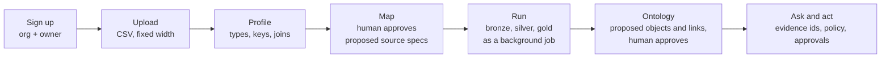

# SaaS MVP: the contract every slice builds against

Status: DECIDED 2026-11-04. Ironwright becomes a hosted, multi-tenant product. This page
supersedes the "local first, never hosted" posture in `platform-architecture.md` and the
old security section of `ROADMAP.md`. Those pages stay as history. The demo packs stay.

## What the MVP is

A team signs up, uploads exports from their old systems, and gets a governed lakehouse,
an ontology over it, and an Ask surface on top. Every step stays gated and evidenced the
same way the synthetic packs are today.



MVP is done when a new org can go from sign-up to a grounded Ask answer over its own
uploaded files on the hosted staging stack, and a second org on the same stack can never
see any of it (proved by tests, not promised).

## Non-goals for the MVP

Billing, SSO/SAML, live database connectors for tenants (upload only), Rust codec, scenario
engine slices beyond slice 1, marketing site changes.

## Rules that stay

Evals gate everything. Rules decide, the LLM narrates. Nothing irreversible before
`interrupt()`. Default deny. Packs are data, the engine is generic. Tenant bytes are
untrusted at every prompt boundary (the S4 fence applies to every tenant workspace).

## Contracts (fixed; change them only with a PR to this page)

### 1. Tenancy model (`ironwright/tenancy/`)

- Metadata store: SQLAlchemy 2 Core, URL from `IRONWRIGHT_DB_URL`. Default
  `sqlite:///<data_root>/meta.sqlite` locally, Postgres when hosted. No ORM magic,
  plain tables, Alembic-free for MVP (create_all plus a `schema_version` row).
- Tables: `orgs(id, slug, name, created_at)`, `users(id, email, pw_hash, created_at)`,
  `memberships(org_id, user_id, role)` with role in `owner|admin|member|viewer`,
  `sessions(token_hash, user_id, org_id, expires_at, last_seen)`,
  `invites(token_hash, org_id, email, role, expires_at)`.
- IDs are `uuid4().hex`. Org slugs match `^[a-z][a-z0-9-]{2,39}$`.
- The request context is `Ctx(org_id, org_slug, user_id, role, principal)`, produced by one
  FastAPI dependency `ctx()`. `principal` is `user:<user_id>` and feeds the existing policy
  engine unchanged. Agent principals still never come from a request.
- S1's in-memory sessions are replaced by the `sessions` table. `IRONWRIGHT_DEV_OPEN=1`
  keeps working for tests and demo-check, mapped to a fixed dev org.

### 2. Storage layout

```
<data_root>/
  meta.sqlite                    (local only; hosted uses Postgres)
  tenants/<org_id>/
    uploads/<upload_id>/<file>   raw bytes, read only after write
    workspaces/<ws_slug>/
      workspace.yaml             the tenant pack (contract 3)
      models/silver/*.sql, models/gold/*.sql
      ontology.yaml, policies.yaml
      run/                       what PackPaths points at today (legacy, lake, traces, ...)
  demo/<pack>/                   the four synthetic packs, read only to every tenant
```

Every path is built with S3's `safe_child`. Nothing outside `tenants/<ctx.org_id>/` is
reachable from a tenant request except `demo/`, read only.

Object storage: when `IRONWRIGHT_LAKE_URI=s3://bucket/prefix` is set, the Iceberg warehouse
for each workspace lives at `<prefix>/tenants/<org_id>/workspaces/<ws>/lake` (works with
R2 and MinIO). Otherwise local paths as above.

### 3. Tenant workspace spec (`workspace.yaml`)

A tenant workspace is a pack with no `generator.py`. Sources point at uploads.

```yaml
kind: workspace
version: 1
title: Acme claims
sources:
  - name: claims
    upload: <upload_id>/claims.csv
    format: csv            # csv | fixed_width
    layout: {delimiter: ",", header: true, encoding: utf-8}   # fixed_width: fields[{name,start,width}]
    columns: [{name: claim_id, type: string, key: true}, {name: amount, type: decimal(12,2)}]
quality: []               # same shape as pack.yaml checks
reconcile: []             # same shape as pack.yaml
```

`load_workspace(org_id, ws_slug) -> Pack` returns the same `Pack` object the engine already
runs, with `verification` level L1. The demo packs keep loading through `load_pack`.

### 4. Jobs (`ironwright/jobs/`)

- Table `jobs(id, org_id, workspace, kind, state, created_by, created_at, started_at,
  finished_at, error, log_path)`. `state` in `queued|running|succeeded|failed|cancelled`.
  Kinds for MVP: `profile`, `run`, `ontology_propose`.
- API: `POST /jobs {kind, workspace, params}` returns `{id}`, `GET /jobs/{id}`,
  `GET /jobs/{id}/log` (tail), `POST /jobs/{id}/cancel`, `GET /jobs?workspace=`.
- Worker: `ironwright worker` claims with `SELECT ... FOR UPDATE SKIP LOCKED` on Postgres
  and a lock row on SQLite. One running job per org (MVP fairness), global cap from
  `IRONWRIGHT_WORKERS`.
- Handlers register by kind: `@job("run") def run(ctx, workspace, params, log)`.

### 5. Upload and profile

- `POST /uploads` (multipart) stores to `uploads/<id>/`, caps from S3 apply (size, count),
  returns `{id, files}`. Allowed: `.csv`, `.txt`, `.dat`, `.tsv`. Everything else is refused.
- `profile` job writes `profile.json` beside the upload: per column type guess, null rate,
  distinct ratio, sample values (capped, never sent to an LLM unless fenced), candidate keys,
  candidate joins across files. Then a proposed `workspace.yaml` the user edits and approves.
- The profiler is deterministic and rule based. An LLM may only narrate the proposal.

## Waves

### Wave 2 (parallel, 5 agents)

| Slice | Owns | Delivers |
|---|---|---|
| T1 Tenancy core | `ironwright/tenancy/`, `auth.py`, `ctx()` dependency, signup/login/invite routes | contract 1, cross-tenant isolation test that walks every route |
| T2 Tenant workspaces | `packs.py`, `config.py` paths, new `workspaces_tenant.py`, `verification.py` | contracts 2 and 3, a fixture workspace from two CSVs that runs green end to end |
| T3 Upload and profiler | new `ironwright/ingest/` | contract 5, profiler golden tests on messy CSV and fixed width fixtures |
| T4 Jobs | new `ironwright/jobs/`, `cli.py worker` | contract 4, run/profile handlers wired to existing stages |
| T5 Hosted stack | `Dockerfile`, `deploy/compose.yaml`, `deploy/railway/`, health routes, S3 lake path | api + worker + Postgres + MinIO up with one command, CI job that boots it and hits `/readyz` |

Until T1 merges, T2 to T4 take `org_id` as a plain argument and use a `DEV_ORG` constant.
Merge order: T1, T2, T4, T3, T5.

### Wave 3

Console onboarding wizard (upload, profile, map, run, ontology review). Ontology proposer
(rule based objects and links from keys and joins, LLM narrates). Per-org quotas and an
optional bring-your-own LLM key. Staging deploy with a seeded demo org. End-to-end
Playwright test of the whole journey. Security pass on the hosted stack (threat model rewrite
from S5, plus the wave 1 follow-ups: escalation identity, orgpolicy traversal, subprocess
memory caps for SQL, Makefile bind addresses).
