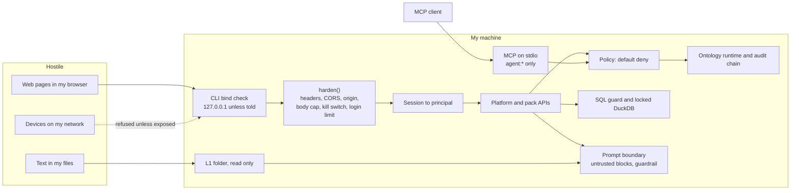

# Threat model: real bytes on a local instance

C4m is the first time my own real files enter a workspace. The demos are synthetic, so until now
nothing here had a secret to lose. This doc says what I protect, from whom, and which test proves
each control. A control with no passing test is not a control.

Scope is one local instance on my own machine. Hosted, multi-tenant use is out of scope, and
nothing here claims it is safe. `tests/test_posture.py` parses this file, so a link to a test that
does not exist fails CI.

## Assets

| Asset | Where it lives | What goes wrong if it leaks or changes |
|---|---|---|
| L1 source files | a folder I point a workspace at | my real data leaves my machine, or gets changed |
| Lake and ontology | `IRONWRIGHT_DATA/<workspace>/` | the copies of that data leak |
| Audit chain | `audit_log` in the ontology DB | I can no longer prove what happened |
| Credentials and sessions | `IRONWRIGHT_DATA/auth/`, process memory | someone signs in as me |
| Identity on an action | the principal the policy engine sees | an action runs as someone it should not |
| LLM keys | `.env`, process env | someone spends my money |

## Actors

| Actor | What they can do | Trust |
|---|---|---|
| Me at the console | signs in, reads, approves | trusted |
| A web page in my browser | sends requests to localhost, including cross-site form posts | hostile |
| A device on my network | reaches any port bound beyond loopback | hostile |
| Text inside my own files | says anything, and reaches Ask narration | hostile |
| An MCP client | calls the tools the server lists | trusted as far as its agent policy says |
| A local process running as me | reads my data directory | out of scope, it already has everything |

## Trust boundaries

## Controls

| Control | What it stops | Proof |
|---|---|---|
| Loopback bind by default | a device on my network reaching the port | `tests/test_posture.py::test_serve_commands_bind_loopback_by_default` |
| Exposure needs `--host` and the spelled out flag | exposing the port by accident | `tests/test_posture.py::test_non_loopback_host_without_the_flag_refuses_to_start`, `tests/test_posture.py::test_the_exposure_flag_cannot_be_abbreviated` |
| Strict CORS, one named origin or none | another site reading my answers | `tests/test_posture.py::test_no_cross_origin_is_allowed_by_default`, `tests/test_posture.py::test_configured_console_origin_is_the_only_one_allowed` |
| Foreign origin writes refused | a cross-site form post, which skips preflight | `tests/test_posture.py::test_foreign_origin_cannot_write_even_without_preflight` |
| CSP, nosniff, no-referrer | injected script, framing by other sites, URL leaks | `tests/test_posture.py::test_csp_lets_the_console_and_bi_frame_work_and_nothing_else`, `tests/test_posture.py::test_security_headers_on_every_answer` |
| Request body cap, chunked included | memory exhaustion | `tests/test_posture.py::test_oversize_declared_body_is_refused`, `tests/test_posture.py::test_oversize_chunked_body_is_refused` |
| Per-IP login limit, on the socket address | password guessing | `tests/test_posture.py::test_login_is_rate_limited_per_ip`, `tests/test_posture.py::test_a_forged_forwarded_header_does_not_buy_more_attempts` |
| Kill switch: `IRONWRIGHT_KILL_SWITCH=1` | Ask and actions misbehaving while I work out why | `tests/test_posture.py::test_kill_switch_covers_every_write_route_and_no_read_route`, `tests/test_posture.py::test_kill_switch_turns_off_mcp_actions_and_leaves_functions` |
| MCP tools are only ontology functions and actions | an agent reaching past the governed surface | `tests/test_posture.py::test_mcp_exposes_exactly_the_ontology_functions_and_actions` |
| MCP identity is server set and always `agent:*` | an MCP client acting as a person or approving | `tests/test_posture.py::test_mcp_caller_cannot_pick_its_identity_or_approve`, `tests/test_posture.py::test_mcp_refuses_to_run_as_anything_but_an_agent` |
| MCP binds no port | the network reaching the agent's tools | `tests/test_posture.py::test_mcp_runs_on_stdio_and_binds_nothing` |
| Default deny, forbid beats permit | an action nobody permitted | `tests/test_engine.py::test_policy_forbid_beats_permit_and_default_deny` |
| Hash-chained audit | rewriting history unnoticed | `tests/test_platform_api.py::test_audit_chain_verifies_over_rest` |
| Workspace isolation | one workspace reading another | `tests/test_workspace_isolation.py::test_nothing_in_one_workspace_is_observable_from_the_other` |
| Real identity on every API route (A1) | anyone who reaches the port acting as anyone | PENDING A1 merge, `tests/test_authn.py` |
| SQL surface locked down and resource capped (A2) | SQL reading my disk, or eating the machine | PENDING A2 merge, `tests/test_sql_surface.py` |
| Paths cannot escape, L1 folders read only (A3) | a request value reaching any file | PENDING A3 merge, `tests/test_paths.py` |
| Untrusted text at the prompt boundary (A4) | text in my files giving the model orders | PENDING A4 merge, `tests/test_prompt_boundary.py` |

## What the kill switch does

It turns off every request that is not a read, not only Ask and actions. Pipeline runs act through
the ontology and approvals execute actions, so leaving them up would not be off. A route added
later is off by default. These POST routes only read, so they stay up: sign in and out,
`/functions/{name}`, `lake/query`, `boards/{slug}/run` and `governance/check`. On MCP, `act_*` tools
answer with an error and `fn_*` tools keep working. It is an env flag, so changing it means a
restart.

## What I have not fixed

These are real and I would rather say so.

- **`ironwright serve` still trusts `X-Principal`.** A1 moves the platform app to real identity. The
  single-pack API has no session path yet, and that is why it binds loopback. Exposing it means
  anyone who reaches it picks their own identity, so policy is a correctness control there, not a
  security control.
- **DNS rebinding is not blocked.** There is no Host allowlist, so a page that rebinds its name to
  127.0.0.1 counts as same-origin. A1's bearer token stops this on the platform app. It does not
  stop it on `ironwright serve`, or with `IRONWRIGHT_DEV_OPEN=1`.
- **`make demo` and `make preview` bind every interface.** They run `python -m http.server`, which
  serves static synthetic files only. The Makefile needs `--bind 127.0.0.1`.
- **The login limit is per process and in memory.** A restart clears it. Behind a reverse proxy every
  client shares one bucket, which fails closed and can lock me out for a minute.
- **The posture comes from the CLI.** `harden()` wraps the app in `cli.py`. Anything that imports
  `create_platform_app()` directly, like `scripts/demo_console_check.py`, runs without it.
- **CSP allows inline styles,** because the console uses React style attributes, and FastAPI's
  `/docs` page renders blank, because it loads script from a CDN. `/openapi.json` still works.
- **`frame-src` is open to any http(s) URL,** because the BI URL is my choice. The frame is sandboxed
  with `allow-same-origin`, so pointing it at the console's own origin would drop the sandbox.
