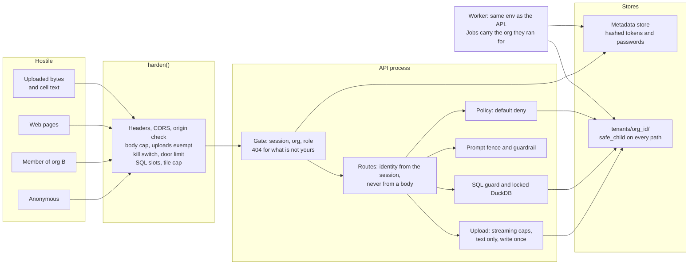

# Threat model: the hosted, multi-tenant product

Ironwright is now hosted, and strangers share one stack. This doc says what I protect, from whom,
and which test proves each control. A control with no passing test is not a control.

Scope is the hosted stack in `docs/saas-mvp.md`: API, worker, Postgres, object storage. The local
tools (`ironwright serve`, MCP on stdio, L1 folders) stay in because they share code, and I mark
where they are weaker. `tests/test_posture.py` parses this file, so a link to a test that does not
exist fails CI.

## Assets

| Asset | Where it lives | What goes wrong if it leaks or changes |
|---|---|---|
| Tenant uploads | `tenants/<org_id>/uploads/` | a customer's real data reaches another customer |
| Tenant workspaces: lake, ontology, reports | `tenants/<org_id>/workspaces/`, or the object store prefix | the same, through the copies |
| Governance records: policies, grants, audit chain | workspace folder, `audit_log` | nobody can prove who allowed what |
| Credentials and sessions | the metadata store, hashed | someone signs in as a customer |
| Who has an account | `users` | a list of a company's staff, and a target list for phishing |
| Identity on an action | the principal the policy engine sees | an action runs as someone it should not |
| Server secrets: LLM keys, store credentials | process env | someone spends my money, or reads every tenant |
| Host details: paths, home directory | the server | a map for the next attack |
| Shared capacity | API and worker processes | one tenant takes the service away from the others |

## Actors

| Actor | What they can do | Trust |
|---|---|---|
| Anonymous | reaches the public port, sends anything to the doors | hostile |
| A member of org A attacking org B | holds a real session and guesses names, ids and paths | hostile past org A's own data |
| A low role inside one org | holds a real session and writes what the role allows, or lies in a body | trusted for their role only |
| Malicious upload | bytes and names chosen by a tenant, read by the profiler and the pipeline | hostile |
| Prompt injection through tenant data | text in a cell that reaches Ask narration | hostile |
| Compromised worker | runs with the worker's env, so it can reach the metadata store and every tenant prefix | see below, I contain little of this |
| A web page in a customer's browser | sends cross-site requests | hostile |
| An MCP client | calls the tools the server lists, on stdio, local only | trusted as far as its agent policy says |

## Trust boundaries

## Controls

| Control | What it stops | Proof |
|---|---|---|
| One org cannot see another's anything, on every route, on SQLite and Postgres | a member of org A reading, writing or learning the name of what org B owns | `tests/test_isolation_routes.py::test_b_gets_the_same_404_on_everything_a_owns_as_on_nothing`, `tests/test_isolation_routes.py::test_a_passes_the_gate_on_every_route_b_was_stopped_at`, `tests/test_isolation_routes.py::test_every_write_on_a_demo_pack_is_refused_for_a_tenant` |
| Workspace isolation on disk | one workspace reading another | `tests/test_workspace_isolation.py::test_nothing_in_one_workspace_is_observable_from_the_other` |
| Real identity on every platform API route | anonymous acting as anyone | `tests/test_authn.py::test_no_token_gets_401_on_every_non_public_route`, `tests/test_authn.py::test_spoofed_header_is_ignored_with_a_token`, `tests/test_authn.py::test_no_account_can_hold_an_agent_principal`, `tests/test_authn.py::test_token_expires_after_8h_idle`, `tests/test_posture.py::test_the_served_platform_app_is_closed_without_a_token` |
| Signup answers alike for new and taken emails, and costs the same slow work | anonymous learning who has an account | `tests/test_security_mt.py::test_signup_answers_alike_for_new_and_taken_emails`, `tests/test_security_mt.py::test_signup_does_the_same_slow_work_for_new_and_taken_emails` |
| Signup on a taken email opens nothing | anonymous getting into an account by signing up for it | `tests/test_security_mt.py::test_signup_on_a_taken_email_writes_nothing_and_hands_out_no_session` |
| Login answers alike for an unknown email and a wrong password | the same, at the other door | `tests/test_security_mt.py::test_login_answers_alike_for_an_unknown_email_and_a_wrong_password`, `tests/test_security_mt.py::test_login_does_the_same_slow_work_for_an_unknown_email_and_a_wrong_password` |
| Per-IP limit on login, signup and accept-invite, on the socket address | password guessing, and bulk email checks | `tests/test_posture.py::test_login_is_rate_limited_per_ip`, `tests/test_posture.py::test_a_forged_forwarded_header_does_not_buy_more_attempts` |
| Sessions travel as a bearer header, never a cookie, so a browser attaches nothing on its own | cross-site request forgery | `tests/test_security_mt.py::test_no_door_sets_a_cookie`, `tests/test_security_mt.py::test_a_session_token_in_a_cookie_is_not_a_credential` |
| Foreign origin writes refused, one named CORS origin or none | a web page writing or reading across sites | `tests/test_posture.py::test_foreign_origin_cannot_write_even_without_preflight`, `tests/test_posture.py::test_no_cross_origin_is_allowed_by_default`, `tests/test_posture.py::test_configured_console_origin_is_the_only_one_allowed` |
| CSP, nosniff, no-referrer | injected script, which is what could read a stored token | `tests/test_posture.py::test_csp_lets_the_console_and_bi_frame_work_and_nothing_else`, `tests/test_posture.py::test_security_headers_on_every_answer` |
| An escalation is raised as the session, and goes to whoever asked | a member getting a grant for, or blaming, someone else | `tests/test_security_mt.py::test_an_escalation_is_raised_as_the_session_whatever_the_body_says`, `tests/test_security_mt.py::test_a_grant_is_decided_as_the_session_and_goes_to_who_asked` |
| Grants, denials and policy applies are recorded as the session | a false name in the governance record | `tests/test_security_mt.py::test_a_grant_is_decided_as_the_session_and_goes_to_who_asked`, `tests/test_security_mt.py::test_a_denial_is_decided_as_the_session`, `tests/test_security_mt.py::test_orgpolicy_apply_is_approved_by_the_session` |
| Escalation values fit their shape exactly | a trailing newline reaching a policy expression | `tests/test_security_mt.py::test_a_trailing_newline_does_not_pass_the_shape_checks` |
| Default deny, forbid beats permit | an action nobody permitted | `tests/test_engine.py::test_policy_forbid_beats_permit_and_default_deny` |
| Hash-chained audit | rewriting history unnoticed | `tests/test_platform_api.py::test_audit_chain_verifies_over_rest` |
| Paths cannot escape, on every request value | a tenant or an upload name reaching any file | `tests/test_paths.py::test_url_encoded_dots_do_not_read_outside_the_root`, `tests/test_paths.py::test_source_read_refuses_a_symlink_that_escapes`, `tests/test_paths.py::test_source_read_refuses_a_fifo_without_hanging`, `tests/test_paths.py::test_copy_leaves_the_source_untouched_and_the_copy_private`, `tests/test_paths.py::test_delete_refuses_a_foreign_folder_that_only_looks_like_an_org`, `tests/test_paths.py::test_ensure_tightens_the_credentials` |
| Org policy and escalation go through `safe_child`, symlinks included | a workspace name reading an `org.json` outside the root | `tests/test_security_mt.py::test_orgpolicy_refuses_a_name_that_leaves_the_data_root`, `tests/test_security_mt.py::test_escalation_refuses_a_name_that_leaves_the_data_root`, `tests/test_security_mt.py::test_org_json_that_is_a_symlink_out_of_the_root_is_refused` |
| Request body cap, chunked included, on everything but `POST /uploads` | memory exhaustion | `tests/test_posture.py::test_oversize_declared_body_is_refused`, `tests/test_posture.py::test_oversize_chunked_body_is_refused`, `tests/test_security_mt.py::test_nothing_else_escapes_the_body_cap` |
| `POST /uploads` is limited by its own streaming caps, and only after the gate | a real export being refused by a limit meant for JSON, or a stranger filling the disk | `tests/test_security_mt.py::test_post_uploads_is_exempt_from_the_body_cap`, `tests/test_security_mt.py::test_a_chunked_post_to_uploads_is_exempt_too`, `tests/test_security_mt.py::test_a_3_mib_upload_works_through_the_served_app`, `tests/test_security_mt.py::test_an_upload_one_byte_over_the_file_cap_is_refused`, `tests/test_security_mt.py::test_the_exemption_does_not_let_a_stranger_stream`, `tests/test_uploads.py::test_the_route_stops_reading_the_body_once_the_cap_trips` |
| An upload must be text with an allowed name, is written once, and leaves nothing if refused | a malicious upload planting a path, a binary or a half written file | `tests/test_uploads.py::test_a_name_that_is_not_one_plain_component_is_refused`, `tests/test_uploads.py::test_a_name_off_the_allowlist_is_refused`, `tests/test_uploads.py::test_binary_bytes_behind_a_text_extension_are_refused`, `tests/test_uploads.py::test_a_half_written_upload_is_not_reachable_by_id`, `tests/test_uploads.py::test_stored_bytes_are_read_only_and_the_folder_is_private` |
| One org cannot read another's upload | a member of org A guessing an upload id | `tests/test_uploads.py::test_another_org_gets_the_same_answer_as_for_nothing`, `tests/test_uploads.py::test_a_profile_job_cannot_reach_another_orgs_upload` |
| SQL surface locked down and resource capped | tenant SQL reading the disk, or eating the machine | `tests/test_sql_surface.py::test_engine_attack_fails_closed_in_explorer`, `tests/test_sql_surface.py::test_engine_attack_fails_closed_in_board_tile`, `tests/test_sql_surface.py::test_cpu_bomb_hits_the_timeout_in_explorer`, `tests/test_sql_surface.py::test_engine_errors_are_short_and_carry_an_id` |
| DuckDB settings show no host path | tenant SQL mapping the server | `tests/test_security_mt.py::test_duckdb_settings_shows_no_host_path_on_a_capped_connection`, `tests/test_security_mt.py::test_current_setting_shows_no_host_path_on_a_capped_connection` |
| SQL requests capped per org, and never queued | one tenant taking every SQL thread | `tests/test_security_mt.py::test_an_org_at_its_sql_cap_gets_429_with_a_retry_after`, `tests/test_security_mt.py::test_the_board_run_route_shares_the_cap`, `tests/test_security_mt.py::test_one_orgs_cap_does_not_touch_another_org`, `tests/test_security_mt.py::test_a_query_holds_a_slot_while_it_runs_and_gives_it_back`, `tests/test_security_mt.py::test_a_handler_that_blows_up_still_gives_the_slot_back` |
| Tiles per board capped at save | one board run costing thousands of query timeouts | `tests/test_security_mt.py::test_a_board_at_the_tile_cap_saves`, `tests/test_security_mt.py::test_a_board_one_over_the_tile_cap_is_refused_and_not_saved` |
| Untrusted text at the prompt boundary | prompt injection through tenant data | `tests/test_prompt_boundary.py::test_every_planted_cell_reaches_the_model_only_inside_a_fence`, `tests/test_prompt_boundary.py::test_echo_model_leaks_nothing_and_falls_back_to_the_template`, `tests/test_prompt_boundary.py::test_ask_model_output_never_reaches_a_function_call`, `tests/test_prompt_boundary.py::test_a_model_citing_an_ungathered_id_is_rewritten` |
| Kill switch: `IRONWRIGHT_KILL_SWITCH=1` | Ask and actions misbehaving while I work out why | `tests/test_posture.py::test_kill_switch_covers_every_write_route_and_no_read_route`, `tests/test_posture.py::test_kill_switch_turns_off_mcp_actions_and_leaves_functions` |
| Loopback bind by default, exposure needs the spelled out flag | exposing a local tool by accident | `tests/test_posture.py::test_serve_commands_bind_loopback_by_default`, `tests/test_posture.py::test_non_loopback_host_without_the_flag_refuses_to_start`, `tests/test_posture.py::test_the_exposure_flag_cannot_be_abbreviated` |
| `make demo` and `make preview` bind loopback | a device on my network reading the local static server | `tests/test_security_mt.py::test_makefile_static_servers_bind_loopback` |
| MCP tools are only ontology functions and actions, on stdio, always `agent:*` | an MCP client reaching past the governed surface, or acting as a person | `tests/test_posture.py::test_mcp_exposes_exactly_the_ontology_functions_and_actions`, `tests/test_posture.py::test_mcp_caller_cannot_pick_its_identity_or_approve`, `tests/test_posture.py::test_mcp_refuses_to_run_as_anything_but_an_agent`, `tests/test_posture.py::test_mcp_runs_on_stdio_and_binds_nothing` |
| The MCP SDK is pinned to major version 2 | installing the old major line | `tests/test_security_mt.py::test_mcp_is_pinned_to_2_and_the_lock_agrees` |

## Why there is no CSRF token

The ticket asks for one if the console uses cookies. It does not. The console keeps its token in
`localStorage` and sends it as `Authorization: Bearer`. A browser never attaches that header on its
own, so a forged request arrives with no session and gets a 401. No route sets a cookie, and no
route reads one. So there is nothing to mark Secure, HttpOnly or SameSite either.

The cost is that any script on the console origin can read the token. CSP is the control there. If
a later change moves sessions to cookies, this section stops being true, and
`tests/test_security_mt.py::test_no_door_sets_a_cookie` goes red to say so.

## What the kill switch does

It turns off every request that is not a read, not only Ask and actions. Pipeline runs act through
the ontology and approvals execute actions, so leaving them up would not be off. A route added
later is off by default. These POST routes only read, so they stay up: sign in and out,
`/functions/{name}`, `lake/query`, `boards/{slug}/run` and `governance/check`. On MCP, `act_*` tools
answer with an error and `fn_*` tools keep working. It is an env flag, so changing it means a
restart.

## What I have not fixed

These are real and I would rather say so.

- **Signup enumeration is closed at the first answer, not the second.** A taken email gets the
  same answer as a new one, but its token gets a 401 on first use, so an attacker learns the truth
  with one more request. Any flow that hands out a session right away has this problem. Closing it
  takes a mailed verification link, and the MVP has no mailer. The door limit keeps this to 10
  guesses a minute per address. The database writes on a new signup also take a few milliseconds
  that a taken email skips. The password hash dominates the time, and I do not hide the rest.
- **A compromised worker can read every tenant.** The worker and the API share one env, one
  metadata store and one storage prefix. Tenant isolation is enforced in my code, not by the
  database or the object store. Fixing it means per-tenant credentials. A job records its org, so I
  can find out what happened afterwards, but nothing stops it.
- **`/workspaces/{name}/approvals/{seq}/decide` still takes `approved_by` from the body.** The gate
  requires an admin session and refuses an agent, but the name it records is client text. The fix
  is in `platform_api.py`, outside this slice.
- **Escalation checks an org role, not the owning role.** Any admin may decide, and that includes
  deciding their own escalation. The record names who did it, so this is visible, not blocked. Org
  roles and a workspace's business roles are not mapped to each other yet.
- **The tile cap is at save, in middleware.** A board saved before the cap can still run with more
  tiles. The SQL slot and each tile's timeout still hold it.
- **The SQL slots and the door limit are per process and in memory.** Two API processes give an org
  twice the slots. A restart clears the door limit. Behind a reverse proxy every client shares one
  door bucket, which fails closed and can lock people out for a minute.
- **`ironwright serve` still trusts `X-Principal`.** It has no session path, and that is why it binds
  loopback. Policy is a correctness control there, not a security control.
- **DNS rebinding is not blocked.** There is no Host allowlist. The bearer token stops this on the
  platform app. It does not stop it on `ironwright serve`, or with `IRONWRIGHT_DEV_OPEN=1`.
- **The posture comes from the entry point.** `harden()` wraps the app in `cli.py` and in the hosted
  entry point. Anything that imports `create_platform_app()` directly, like
  `scripts/demo_console_check.py`, runs without it.
- **`IRONWRIGHT_DEV_OPEN=1` opens the door, and body identity with it.** Only the exact value `1`
  does, and the console shows a red badge. Nothing stops an operator setting it on a hosted stack.
- **FastAPI's `/docs` page renders blank on `ironwright serve` under the CSP,** because it loads script
  from a CDN. `/openapi.json` still works there. The platform app has neither.
- **`frame-src` is open to any http(s) URL,** because the BI URL is the customer's choice. The frame is
  sandboxed with `allow-same-origin`, so pointing it at the console's own origin would drop the
  sandbox.
